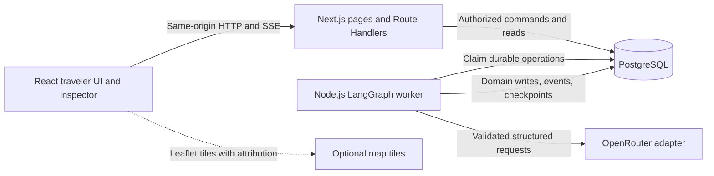

# Runtime and Application Architecture

Status: implementation specification, not application code. Source: `ODFT_BRIEF.md`, including the mandatory route-feasibility addendum.

## 1. Decision

Use one TypeScript npm-workspace repository, a self-hosted Next.js web application, one dedicated Node.js LangGraph worker, and PostgreSQL. Next.js owns the browser-facing backend-for-frontend (BFF). The worker has no public HTTP API. Both processes use the same database through separate bounded connection pools.

PostgreSQL is the only infrastructure dependency. It stores domain entities, immutable scenario snapshots, durable work requests, execution events, and the official LangGraph PostgreSQL checkpointer tables. Do not add Redis, a message broker, a separate REST service, an ORM, or an autonomous-agent platform.

This is a small durable-job design, not a general-purpose workflow engine: LangGraph remains responsible for routing, parallel work, bounded loops, interrupts, and resumable orchestration. The job table only makes graph invocation survive the web request and process lifetime.

## 2. Topology



The normal path is browser -> BFF -> durable operation -> worker -> PostgreSQL -> BFF SSE/read projection -> browser. An HTTP `202 Accepted` means a command was queued, not that a booking or modification succeeded.

### Why not run graphs inside a Next.js request?

A request-scoped implementation is initially smaller but couples execution to request cancellation, host timeouts, deploys, and browser reconnection. Untracked promises are not restart recovery. A separate worker adds one process while giving graph operations a durable owner and keeping the frontend responsive. Do not target serverless hosting in this proof of concept.

### Why not a separate Node.js API service?

It would duplicate routing, authentication, CORS, and deployments without improving graph durability. Next.js Route Handlers plus the worker provide the needed separation without another HTTP boundary.

## 3. Repository Layout

The following paths are the target layout to create during implementation, not existing modules:

```text
apps/web/                         Next.js, App Router, UI, BFF, SSE
apps/worker/                      Job claiming, graph driver, graceful shutdown
packages/contracts/src/           Zod schemas, public DTOs, strict command unions
packages/domain/src/              Preferences, dates, feasibility, booking, validation
packages/data/src/                Geographic imports and synthetic providers
packages/ai/src/                  Role configuration, prompts, adapters, fixtures
packages/workflow/src/            StateGraph, nodes, reducers, invalidation
packages/persistence/src/         pg repositories, migrations, transactions
data/reference/                  Versioned filtered offline reference assets
data/manifests/                  Source versions, checksums, licenses, attribution
tests/integration/                PostgreSQL and LangGraph tests
tests/e2e/                        Playwright journeys and restart tests
scripts/                         Migrations, reference import, demo setup
docs/planning/                   This specification and phase instructions
```

Use npm workspaces and a single committed lockfile. Do not introduce Nx or Turborepo. Build shared packages before applications. Development may use `tsx`; production runs emitted Node.js code and `next start`, never a development transpiler.

## 4. Dependency Boundaries

| Module | Responsibility | Forbidden responsibility |
| --- | --- | --- |
| contracts | Runtime schemas, command/decision/API contracts | Database clients, secret configuration, LLM SDKs |
| domain | Deterministic business rules and typed errors | LLM calls, browser state, graph scheduling |
| data | Reference lookup, seeded generation, provider implementations | Booking mutations, user approval |
| ai | Intent interpretation, explanations, candidate ordering, planning/review proposals | SQL writes, invented offers, executable arbitrary operations |
| persistence | SQL, atomic booking commits, immutable artifacts, operation/event ledger | Making itinerary or AI decisions |
| workflow | Orchestration, routing, parallelism, interrupts, bounded retries | Reimplementing pricing, authorization, feasibility, or booking rules |
| web | Session/ownership checks, validation, command admission, responsive UI | Calling OpenRouter from the browser, running graph jobs inline |
| worker | Exclusive trip execution, recovery, checkpoint driving | Public authentication endpoints, new business rules |

Browser imports are limited to public contracts and UI-safe pure helpers. Mark web database/configuration modules server-only and verify that production client bundles do not contain secrets or `pg`/LangGraph server dependencies.

## 5. Sources of Truth

1. PostgreSQL domain records are authoritative for preferences, route inputs, selected offers, reservations, conversation, proposals, itinerary versions, scenario manifests, and execution events.
2. LangGraph checkpoints are authoritative for graph position, pending tasks/interrupts, bounded-loop counters, and orchestration references.
3. A checkpoint contains IDs and compact typed results, not complete reference datasets, scenario inventories, conversation transcripts, or a second mutable booking database.
4. UI state is a cache of the authorized read projection plus unsaved form edits. A selected card is not a confirmed reservation.

Store source fingerprints on every derived artifact. A graph reference is usable only when its fingerprint matches the current relevant domain inputs. `trip.revision` is an optimistic-concurrency token, not proof that a route or itinerary is feasible.

See [domain contracts](04-domain-model.md) and [graph recovery](03-langgraph-design.md).

## 6. Command Admission and Concurrency

Every UI operation and interpreted chat operation uses the same strict command schema and deterministic command dispatcher.

For a state-changing request, the BFF performs the following transaction:

1. Validate session, ownership, CSRF/origin, rate limits, body size, and command schema.
2. Look up `(trip_id, request_id)` first. Return the existing result for the same payload hash; reject reuse with a different payload.
3. Lock the trip row with `SELECT ... FOR UPDATE`.
4. Compare the supplied `expectedRevision` with the current `trip.revision`.
5. Reject a new conflicting request with `409 OPERATION_IN_PROGRESS` if a queued/running operation exists.
6. Check whether this command may enter the current decision; destructive route changes need a replacement/cancellation review.
7. Increment `trip.revision` once and insert the immutable operation payload with its accepted revision.
8. Commit and return the operation ID plus the new revision.

Only accepted user requests advance `trip.revision`. Worker-derived writes have their own artifact versions and are guarded by the operation ID and relevant input fingerprint. While the worker is active, new conflicting writes are rejected rather than interleaved. The UI refreshes after a stale-revision conflict and never automatically retries a different command against a new revision.

Trip creation has no existing `expectedRevision`: validate the complete welcome+destination input, deduplicate by the unique `(session_id, creation_request_id)` on `trips`, compare the creation payload hash, and create the trip with revision 1 plus its initialization operation in one transaction. Duplicate creation returns the same trip/operation. A changed payload under the same key is a conflict, not another trip.

A partial unique index enforces at most one operation in `queued` or `running` status per trip. A graph suspended at an interrupt has no running operation and can accept a decision response or supported modification. An unfinished failed checkpoint instead sets `recoveryRequired`; ordinary commands are rejected with `409 RECOVERY_REQUIRED` until the original operation is recovered. Do not accept a new message and accidentally resume old unfinished work without applying it. A terminal failure of a decision resume reaches it after the interrupt was consumed, so it finalizes as an unfinished failure (`failed` + `recoveryRequired` + `last_unfinished_operation_id`) instead of restoring a dead decision, and a rejected resume on unfinished work owned by another operation records owner recovery for that checkpoint owner (2026-10-13). Two simultaneous commands with the same revision have a deterministic winner; the other receives `409 STALE_REVISION` or `409 OPERATION_IN_PROGRESS` and makes no domain change.

### Explicit technical retry

`POST /api/trips/:id/operations/:operationId/retry` authorizes owner/origin/CSRF, validates request ID/payload hash and current revision, locks the trip, and requeues only its latest failed unfinished operation. It keeps the same immutable input, operation ID, accepted revision, effect scopes, and graph/provider/LLM counters. It records a control-request result and a new explicitly authorized recovery round; each round permits at most three automatic claims, while total claim/round counters stay monotonic. This technical control does not admit a new business command or increment `trip.revision`. Duplicate control requests return their stored result. No unrelated command may interleave before the recovered invocation reaches a decision or `END`.

### Worker ownership

- Claim eligible operations with `FOR UPDATE SKIP LOCKED`, a lease expiry, and a monotonically increasing fencing token.
- Acquire a session-level PostgreSQL advisory lock for the trip on a dedicated connection. Hold it throughout one graph invocation; release it on completion or shutdown.
- A live advisory lock prevents another worker from stealing a merely slow invocation. A lost lock/heartbeat connection aborts local work immediately.
- Domain/event writes require the current operation fencing token and accepted revision. Lease renewal runs more frequently than lease expiry.
- If the worker crashes, PostgreSQL releases the advisory lock. After lease expiry, another worker claims the same operation and recovers the same graph thread, not a new trip.
- Checkpoint access follows the same single-writer rule. Never allow web handlers and workers to invoke the same thread concurrently.

Checkpoint writes need fencing as well as domain writes: a lost advisory-lock connection must not leave an old process writing through a still-healthy checkpointer pool. Wrap the official saver write methods (`put`, `putWrites`) with a small operation-bound guard. The guard acquires a separate short transaction-scoped `checkpoint-write:<tripId>` advisory gate, reads the current operation/fencing token, delegates the official write only if still current, and releases the gate after the delegated write finishes. Lease claim/fencing-token rotation acquires the same gate before committing a new token. Thus an already admitted write finishes before token rotation, and every later stale write is rejected. The guard does not modify official table formats or pretend that domain/checkpoint commits are atomic.

The guard carries the immutable current driver operation context, not a token read from old checkpoint state. Its ownership read is non-locking; do not hold an operation-row lock inside the checkpoint gate and create a lock-order cycle with job claiming. Use a separate bounded saver pool so the outer guard transaction cannot starve its own delegated write. No SQL transaction spans an LLM call. Phase 05 tests stale checkpoint writes as well as stale reservation writes after lock loss.

Head reads (no explicit `checkpoint_id`) resolve the causal leaf: the newest checkpoint that no other checkpoint names as its parent. The library's checkpoint-ID generator keeps its monotonic clock per module instance (ESM and CJS builds have separate state), so IDs written within one run can sort backwards and the plain `ORDER BY checkpoint_id DESC` would return a mid-run checkpoint — a completed run would then finalize against a stale view (2026-10-13). The fenced saver implements the leaf resolution; explicit `checkpoint_id` reads stay untouched so task-ID derivation is unchanged.

Default lease: 60 seconds; renew every 15 seconds. External LLM calls have deadlines below the lease and an abort signal. Graceful shutdown stops claims, aborts or finishes current work within 30 seconds, and leaves unfinished operations recoverable.

## 7. Transactions and Checkpoint Reconciliation

The official LangGraph checkpointer and domain repositories do not share an implicit atomic transaction. Do not claim that a checkpoint and a reservation commit atomically.

Each mutating node has an idempotent effect key: `(operation_id, node_name, effect_scope)`. The SQL transaction writes the domain effect and effect-ledger result together. On replay, the node returns the stored result. Booking confirmation has additional request-key and active-reservation uniqueness checks.

If a domain commit succeeds and its checkpoint fails, recovery repeats the node and reads its existing effect result. If a checkpoint is written but the operation-completion event is missing, recovery inspects the checkpoint and repairs the read projection/event ledger without booking again. Checkpoint errors are not converted into fabricated success.

Effect scopes include proposal ID or itinerary attempt where one node can intentionally execute more than once. A successful old hotel search is not used for a new hotel input fingerprint. See [booking simulation](09-booking-simulation.md).

## 8. Read API and Streaming

The BFF reads domain projections. The worker publishes structured, persisted execution events. Do not scrape private graph internals or expose prompts, credentials, raw SQL, or chain-of-thought.

| Route | Contract |
| --- | --- |
| `POST /api/session` | Create/renew anonymous session; return CSRF token and expiry |
| `GET /api/reference/countries?q=` | Offline admitted-country search |
| `GET /api/reference/cities?country=&q=&cursor=` | Offline city search with coverage flags |
| `GET /api/reference/airports?q=&cursor=` | Offline European origin autocomplete |
| `GET /api/reference/cities/:id/airports` | Suitable nearby/cross-border airports and estimated transfers |
| `POST /api/trips` | Validate welcome/destination input and enqueue initialization |
| `GET /api/trips/:id` | Authorized complete read projection, revision, active operation, pending decision |
| `POST /api/trips/:id/commands` | Admit a strict UI command or bounded chat message |
| `POST /api/trips/:id/resume` | Admit a response to the exact current decision |
| `GET /api/trips/:id/events?after=` | SSE replay and live delivery of persisted events |
| `GET /api/trips/:id/operations/:operationId` | Durable status, outcome, and safe error information |
| `POST /api/trips/:id/operations/:operationId/retry` | Explicit bounded technical recovery of the same unfinished operation, not new business input |

All endpoints use Zod. Existing-trip business/decision/control writes use `requestId` and `expectedRevision`; creation has no existing revision and session bootstrap is a separate origin-protected contract. Responses distinguish accepted/waiting/succeeded/failed. HTTP errors use `{ code, message, retryable, currentRevision?, operationId? }`, never raw provider exceptions.

SSE events have monotonic database IDs, `tripId`, `operationId`, timestamp, type, node/domain, attempt, and a small schema-validated payload. Serialize the bigint event ID/cursor as a decimal string, not a lossy JavaScript number or JSON BigInt. Reconnect using `Last-Event-ID` or `after`, authorize before replay, and deduplicate by event ID. A 15-second heartbeat keeps idle connections alive. Polling `GET /api/trips/:id` is the fallback if SSE is unavailable.

Next.js routes using the database/SSE run in the Node.js runtime, not Edge. SSE routes are dynamic, unbuffered, non-cached, and terminate on disconnect. Notifications may use PostgreSQL `LISTEN/NOTIFY` as a latency hint, never as the durable source; periodic event reads recover missed notifications.

## 9. Runtime Configuration

Validate configuration at startup and fail with actionable errors. Configuration is server-side, with only safe display flags exposed through the read projection.

| Setting | Rule/default |
| --- | --- |
| `DATABASE_URL` | Required server secret; never log it |
| `PUBLIC_BASE_URL` | Exact origin used by cookie/CSRF checks |
| `SESSION_HMAC_KEY` | Required random server secret, no built-in production value |
| `AI_MODE` | `fixture` by default; `openrouter` requires valid role profiles and credentials |
| `OPENROUTER_API_KEY` | Required only in OpenRouter mode |
| `AI_CONFIG_PATH` | Server-only JSON role profiles; see [AI design](06-ai-agent-design.md) |
| `MAX_PLANNING_ATTEMPTS` | 3 total attempts, not 3 additional retries |
| `MAX_PROVIDER_ATTEMPTS` | 2 total attempts per affected domain per operation |
| `MAX_LLM_CALLS_PER_TRIP` | 40 attempted billable calls including retries |
| `MAX_LLM_COST_USD_PER_TRIP` | 1.00 default; reserve estimated worst-case cost before calls |
| `DEMO_CONTROLS_ENABLED` | Enabled locally; disabled by default outside demo deployment |
| `MAP_TILE_URL` | Optional policy-compliant tile source; no tiles means offline fallback |
| `WORKER_CONCURRENCY` | 2 trips; never concurrent invocations of one trip |

Local `.env` files are ignored. `.env.example` contains names and placeholders, not real keys. Production requires HTTPS, secure cookies, explicit origin, and a least-privilege database role.

## 10. Local Operation Contract

Phase 01 establishes these commands; they do not exist in the current planning-only repository:

```text
npm ci
docker compose up -d postgres
npm run db:migrate
npm run checkpointer:setup
npm run dev
npm run typecheck
npm run lint
npm run test:unit
npm run test:integration
npm run test:e2e
npm run build
```

`npm run dev` runs the web application and worker as tracked sibling processes, with shutdown forwarding. Database setup/migrations are explicit one-shot commands, not concurrent application-startup races. The checkpointer setup is run once per installation before workers start.

Container startup uses PostgreSQL health checks and an explicit migration/setup step. `docker compose down` preserves the volume; only an explicitly requested local reset may remove it. Readiness checks database connectivity, migrations, checkpointer schema, and worker heartbeat. Liveness does not call OpenRouter or tiles.

## 11. Fixed Constraints and Non-goals

- No paid travel APIs, online geocoding, actual booking systems, or payments.
- No user registration/login; anonymous sessions still enforce ownership.
- No claim that synthetic prices, schedules, places of business, route estimates, or availability are real.
- No LLM authority over feasibility, prices, booking writes, authorization, or state mutation.
- No checkpoint-only route approval: generation and booking verify the current approval fingerprint against domain data.
- No multi-trip worker execution without trip-level exclusion.
- No deployment platform selection, production-scale queue, authentication provider, or real-provider adapter implementation in the proof of concept.

## 12. Related Specifications

- [LangGraph](03-langgraph-design.md): state/reducers, invocation/recovery, decisions, invalidation.
- [Domain](04-domain-model.md): SQL constraints, strict contracts, source fingerprints.
- [Synthetic data](05-synthetic-data-design.md): geography, timing, pricing, snapshots.
- [Security](10-security-reliability.md): admission, rate limits, untrusted text, ownership.
- [Roadmap](12-implementation-roadmap.md): dependencies and phase gates.
