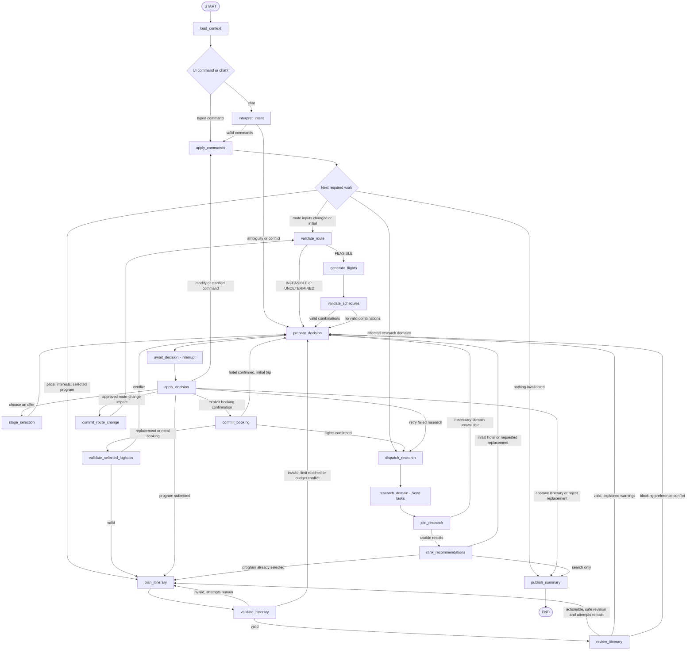
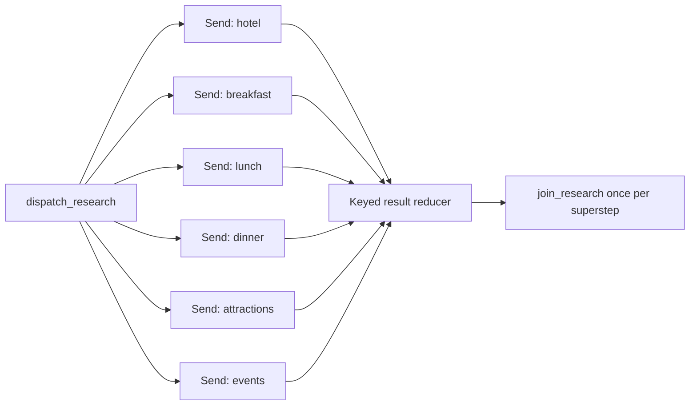
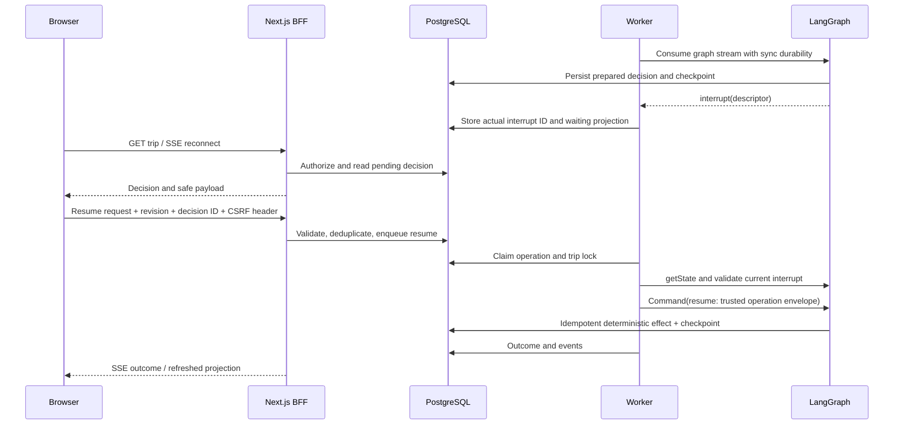
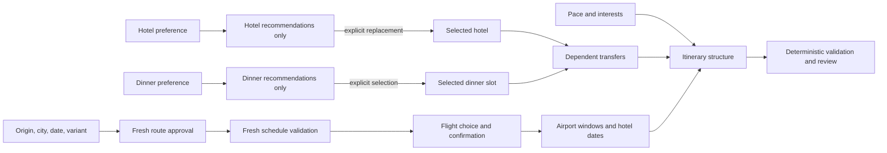

# LangGraph Workflow Specification

## 1. API Baseline and Purpose

Use the TypeScript Graph API: `StateGraph`, `StateSchema`, Zod, `ReducedValue`, `Send`, `interrupt`, and `Command`. Do not use a prebuilt autonomous agent, an LLM-driven supervisor, a Python service, or LangGraph Platform.

API behavior was checked against the official JavaScript documentation and published `@langchain/langgraph` 1.4.21 / PostgreSQL checkpointer 1.0.6 on 2026-10-10. See [source references](#12-verified-api-references). Pin these compatible versions initially; an upgrade requires the checkpoint/resume contract suite before changing the lockfile.

The graph is essential: it gates flight generation, fans out research, joins typed results, loops on invalid plans, pauses for explicit decisions, preserves state across restarts, and selectively re-enters after completion. Deterministic services own business rules and mutations.

## 2. Main Graph

The reused `prepare_decision`/`await_decision` nodes carry a strict `DecisionKind`. In the inspector display the actual kind, such as `await_decision: flight_choice`, `booking_confirmation`, `hotel_choice`, or `itinerary_approval`. One generic interrupt node avoids duplicate logic while preserving the mandatory human decisions.

Missing flights, missing hotels, and rejected route validation do not fall through to later stages. Search-only changes may end after presenting alternatives; they do not force a replacement or itinerary regeneration.

## 3. State and Ownership

Use `StateSchema` with Zod runtime validation. The compact checkpoint contract is:

| Channel | Owner/update rule |
| --- | --- |
| `stateSchemaVersion`, `graphVersion`, `tripId` | Immutable validated initialization values |
| `operationId`, `acceptedRevision`, `operationKind` | Accepted operation identity, kinds `start`, `command`, `resume`; recovery is a driver-context mode, not new business input |
| `commandRef`, `conversationMessageRef`, `intentRef` | IDs of validated persisted inputs, not entire conversation |
| `routeInputFingerprint`, `routeValidationRef`, `scheduleValidationRef` | Replaced only by serial route/schedule nodes |
| `scenarioSnapshotRef` | Immutable snapshot/version reference; never full inventory |
| `requiredDomains`, `researchRunId` | Unique bounded domain array and operation/run scope |
| `researchResults` | Reducer map keyed by `researchRunId:domain`; each value is a small tagged result/ref |
| `pendingDecisionRef` | One current domain decision; its actual checkpoint/interrupt binding is stored by the driver in the domain projection |
| `proposalRef`, `itineraryRef`, `validationRef`, `reviewRef` | Persisted artifact references with source fingerprints |
| `planningAttempt`, `providerAttempts` | Per-operation counters, total-attempt limits |
| `nextWork` | Enum: `route`, `research`, `hotel_choice`, `program`, `plan`, `logistics`, `summary`, `decision` |
| `lastOutcome` | `success`, `waiting`, `blocked`, or typed recoverable failure |

No database handles, secret tokens, provider clients, raw prompts, model reasoning, or large datasets belong in checkpoint state. Pass server dependencies through the non-checkpointed invocation `context`; never rely on "private" state channels as a security boundary.

New runs after `END` explicitly reset per-operation counters, pending refs, work scope, and research run ID. Serial reference channels are nullable and are cleared with `null`, not an omitted/undefined update. Reducer channels persist across invocations, so merging `{}` does not clear a map. Use a serial-node `Overwrite` when deliberately resetting a reducer, or prune old scopes to a bounded history after completion. Never clear reducer state from parallel workers.

The domain store remains authoritative. Hydration checks source fingerprints before using old refs. A same-trip checkpoint is not evidence that the origin/city/date are unchanged.

## 4. Node Contracts

| Node | Input | Output/effect | Retry/side-effect policy |
| --- | --- | --- | --- |
| `load_context` | Trip and operation refs | Valid current context, source hashes, next-work requirements | Read-only; rejects unsupported graph/schema versions |
| `interpret_intent` | Chat ref and compact authorized context | Strict persisted intent or clarification ref | AI adapter owns at most one retry; no mutations |
| `apply_commands` | Valid command/intent ref | Idempotent preferences/search intent changes; invalidation set or route-change proposal | Domain transaction with effect key; no silent booking change |
| `validate_route` | Current route inputs/reference versions | Persisted Stage A result and current fingerprint | Deterministic; must precede generation |
| `generate_flights` | Fresh `FeasibleRouteApproval` | Stable persisted scenario flight candidates/ref | Generator independently verifies approval; idempotent |
| `validate_schedules` | Current Stage A and candidate combinations | Stage B valid IDs or structured no-offer result | Deterministic and no invented repair |
| `prepare_decision` | Typed reason/kind and valid artifacts | Persisted descriptor; state stores safe ref only | Idempotent creation, before interrupt; effect scope includes preceding resolved decision/proposal ID |
| `await_decision` | Exact descriptor and interrupt payload | Valid trusted resume envelope, new operation identity/counters, or suspension | One `interrupt()`; no side effects and no broad catch; recovery of same operation does not reset counters |
| `apply_decision` | Authorized response and descriptor | Next-work enum, proposal action, or validated command ref | Idempotent resolution; freshness and membership rechecked |
| `stage_selection` | Valid current offer ID | Proposed selection, before/after prices, replacement impact | No confirmation; old reservation stays active |
| `commit_booking` | Explicit confirmed proposal | Deterministic reservation service result | Atomic idempotent SQL; no LLM calls |
| `commit_route_change` | Explicit impact confirmation | New route inputs; affected reservations explicitly cancelled/superseded as previewed | Atomic SQL; invalidate both feasibility stages |
| `dispatch_research` | Required/failed domains and current hashes | Ensure missing inventories once after confirmed valid flights, then new `Send` tasks, or direct continuation for zero domains | Idempotent single snapshot extension before fan-out; resets only current work scope |
| `research_domain` | One domain, snapshot, source fingerprint, attempt | Tagged success/unavailable/retryable-error ref | Read-only provider plus idempotent artifact write; bounded failure injection |
| `join_research` | All scheduled task results | Merged retained successes, necessary-domain gate, failed-domain retry scope | Verifies expected result set, not completion ordering |
| `rank_recommendations` | Existing valid candidates and relevant preferences | Valid ordered IDs and supported explanation | Deterministic default; optional AI tradeoff ranking |
| `validate_selected_logistics` | Confirmed/current services and date/route refs | Hotel/meal/airport compatibility or explicit conflict | Deterministic; never edits reservations to make it pass |
| `plan_itinerary` | Selected/confirmed services, candidate IDs, fixed constraints, feedback | Immutable proposed itinerary version; attempt increment | AI/fixture proposal only; costs/route metrics resolved by code |
| `validate_itinerary` | Proposal and current fingerprints | Structured deterministic errors/warnings/metrics | Invalid result is normal routing, not an exception retry |
| `review_itinerary` | Deterministically valid itinerary, interests/pace | Structured qualitative review, proposed safe revision or warnings | AI/fixture; never overrules deterministic rejection |
| `publish_summary` | Committed domain outcomes/current artifacts | Persisted safe summary, conversation result, terminal projection | Idempotent; states proposals versus completed changes precisely |

Every mutating node delegates to a domain/repository service. A thrown database/checkpoint failure fails the operation; it does not become an apparently valid empty result. Catch only known simulated/provider errors inside research tasks.

## 5. Parallel Research and Reducers

Domains are `hotel`, `breakfast`, `lunch`, `dinner`, `attractions`, and `events`. Split meals so a dinner-only override does not rerun breakfast/lunch. Providers are deterministic; parallelism does not create six conversational agents.

Use `Send("research_domain", { domain, researchRunId, ...validatedRefs })` for each affected domain and a single static edge from `research_domain` to `join_research`. The Graph API superstep barrier schedules the join after the sent tasks complete. For zero domains, route directly to the next serial node; do not wait for a fan-in that can never fire.

Reducer contract: merge unique scope/domain keys, replace an equal key only with the same idempotent result, and reject conflicting same-key results. Result ordering is not meaningful; sort by domain when displaying it. Each sent task writes only its own keyed result and artifact. The join verifies that every scheduled key exists, and retains prior-domain refs whose fingerprints still match.

Do not construct an all-branches static barrier for selective work. Never route both through a static edge and `Command(goto)` from the same node: both paths can execute. Each node uses one outgoing routing mechanism.

Known provider failure is a tagged domain result, allowing successful siblings to join. On automatic retry, create a new research-run scope, send only the failed domains, and keep total attempts <= 2. This allows an error result to become a success under a new key without violating identical-only same-key reducer semantics. Run-scope creation is idempotent under the dispatch effect key. If an unexpected sibling exception aborts the superstep, PostgreSQL pending writes retain completed tasks; crash/error recovery uses `invoke(null)` so only unfinished tasks rerun. Idempotent provider/artifact writes still protect the commit-before-checkpoint window.

## 6. Conditional Routing Table

| Condition | Action | Preserved state |
| --- | --- | --- |
| Stage A `FEASIBLE`, matching fingerprint | Generate flights, then Stage B | Stable unrelated data |
| Stage A `INFEASIBLE` | Recovery decision explaining reason and alternative origin/city | No new downstream effects |
| Stage A `UNDETERMINED` | Conservative limitation decision; require supported alternative | No invented flight generation |
| Stage B no valid combination | Explain schedule reason; offer date/variant/origin/city changes | No booking/research progression |
| Flight choice | Stage proposal, then interrupt for explicit confirmation | No reservation until confirmation |
| Flight confirmed | Dispatch independent research | Existing approved flight reservation |
| Necessary hotel domain unavailable | Bounded retry or recovery decision | Flights and successful research results |
| Restaurant/events unavailable | Explain missing option; block missing mandatory meal or use explicitly allowed fallback | Other valid research |
| Hotel choice/replacement | Proposal then explicit booking/replacement confirmation | Old confirmed hotel until commit |
| Preference-only service change | Refresh affected recommendations, present alternatives | All selections/reservations and current schedule |
| Pace/interests change | Replan program, validate, review | Flights/hotel/confirmed meals |
| Deterministic invalid schedule, attempt < 3 | Replan with machine-readable feedback | All fixed reservations |
| Budget exceeded | Stop automatic loop; lower-cost alternatives or budget clarification | No automatic downgrades/replacements |
| Attempt limit reached | Recovery/clarification decision with best valid partial information | No invalid approval |
| AI ambiguity/contradiction | Clarification interrupt | No proposed command executed |
| Itinerary approved | Publish summary and `END` | Thread/checkpoints remain available |
| Completed trip receives new request | New plain-input invocation on same thread | Compatible existing domain state |
| Existing pending decision receives modification | Resume with worker-created `modify` response, then apply command | Safe unaffected state; old decision explicitly resolved/cancelled |

For initial planning, hotel selection is followed by a `program_choices` interrupt containing breakfast/lunch/dinner defaults and activity choices. The user can accept recommendations or select alternatives through normal controls before building the itinerary. Optional meal reservations use the same serialized proposal/confirmation flow, not an automatic booking hidden inside itinerary generation.

## 7. Interrupt and Resume Sequence

Persist the surfaced LangGraph interrupt ID from `getState().tasks[].interrupts` alongside the domain descriptor. They are different identifiers. This design permits one pending human decision at a time and no interrupts inside parallel research, avoiding multiple-interrupt matching ambiguity.

`interrupt()` payloads are small JSON-serializable descriptors. Use its Zod `responseSchema` for the internal `GraphResumeEnvelope` as an additional runtime guard, while domain authorization/freshness remains outside model control. The envelope carries the admitted new operation identity/revision and a public response or worker-only modification reference. The resumed node updates serial state from this envelope, not from the old checkpoint operation ID. On restart, read the pending descriptor and checkpoint rather than creating a new question.

The interrupt node restarts from its beginning when resumed. Do not write a booking, create a proposal, charge a budget, emit a non-idempotent event, or increment a counter before the interrupt. Do not wrap the interrupt in a catch that swallows `GraphInterrupt`.

## 8. Invocation and Recovery Contract

The worker is the only graph invoker. Thread ID is the trip UUID. Acquire operation lease/fencing and trip advisory lock, then reconcile the authoritative domain inputs and `getState` before selecting the call. Use the operation-bound fenced wrapper around official saver writes described in [architecture](02-architecture.md#6-command-admission-and-concurrency); domain fencing alone cannot protect a checkpoint written after lock loss.

| State and admitted operation | Invocation |
| --- | --- |
| New thread | Plain validated initial input |
| Completed thread, new command/chat | Plain new-operation input; begins again at `START` with persisted state |
| Current dynamic interrupt, exact answer/modification | `new Command({ resume: trustedGraphResumeEnvelope })` |
| Crashed/errored invocation with unfinished tasks and no unanswered interrupt | `null` on the same thread; resume unfinished work |
| Unanswered dynamic interrupt during recovery | Restore waiting projection; do not invent a resume answer |
| Current interrupt, accepted resume/modification operation crashed before its answer was checkpointed | Revalidate/replay the original persisted envelope under the same operation ID; reuse already stored decision/effect results |
| Completed checkpoint, job outcome missing | Reconcile terminal outcome; `null` would be a no-op |
| Unfinished failed checkpoint, new ordinary command | Reject `RECOVERY_REQUIRED`; do not interpret/ignore a new request while resuming old work |
| Explicit owner technical retry of the latest failed unfinished operation | Requeue the same operation/input and follow unfinished-recovery or accepted-envelope replay rules |
| Resume request but no matching interrupt | Return stale-decision conflict; do not invoke |
| No checkpoint after worker crash before first invoke | Start the original persisted input exactly once under the same operation effect keys |

Do not use input `Command({ update })` to start a new run after `END`, and do not use `null` to enter a new modification. `getState` reports pending tasks/errors/interrupts; completing a stream alone does not prove success.

Each invocation uses `configurable: { thread_id }`, top-level `durability: "sync"`, top-level `recursionLimit: 100`, server `context` including the authoritative current operation/fencing identity, and an abort `signal`. Effects use that context and validate any checkpoint operation ref against it. The 100-superstep guard is a last-resort safety bound, not the itinerary iteration policy. Default LangGraph recursion 25 may be too low for selection/confirmation plus revision cycles. Bound provider and planning attempts explicitly in state/domain records.

Consume the entire worker stream and await checkpoint writes before releasing ownership or marking success. Stream only safe projected `updates`, `custom`, and checkpoint/task summaries into persisted events; never forward raw `values`, `debug`, prompt content, or token reasoning to the browser. See [inspector UX](08-frontend-ux.md).

## 9. Bounded Work and Retry Ownership

| Operation | Bound and owner |
| --- | --- |
| Plan -> validate -> qualitative review -> replan | 3 total plan attempts per user operation; graph owns loop |
| Recoverable research provider failure | 2 total calls per affected domain per operation; graph sends failed subset |
| Invalid structured LLM output / transient OpenRouter failure | 2 total calls including one repair/retry; AI adapter owns retry |
| Booking/domain transaction | Replay through effect ledger; no external side effect to retry |
| Checkpoint/database failure | Fail current operation safely; durable driver recovery after bounded backoff |
| Driver recovery | 3 automatic claims per recovery round; exhaustion needs explicit technical retry of the same operation; total counters never reset |

Do not stack a graph retry policy on top of an adapter retry for the same LLM call. Do not catch validation errors and retry indefinitely. Abort/authentication/model-capability/schema errors are not transient provider failures. Human-triggered later retries are new admitted operations and remain subject to session and trip cost limits.

## 10. Selective Invalidation Matrix

`R` refreshes recommendations only. `V` validates dependent logistics. `P` creates a new itinerary proposal. `X` requires explicit impact confirmation before incompatible booked state changes. `-` preserves the domain and content hash.

| Change | Stage A/B + flights | Hotel | Breakfast | Lunch | Dinner | Activities/events | Itinerary |
| --- | --- | --- | --- | --- | --- | --- | --- |
| Hotel level / cheaper-hotel search | - | R; keep booking | - | - | - | - | V only if proposal chosen; P after confirmed replacement |
| Breakfast override | - | - | R; keep booking | - | - | - | V/P after approved selection change |
| Lunch override | - | - | - | R; keep booking | - | - | V/P after approved selection change |
| Dinner override | - | - | - | - | R; keep booking | - | V/P after approved selection change |
| Global service level | - | R if inherited | R if inherited | R if inherited | R if inherited | - | No selection changes; V/P only after accepted alternatives |
| Activity pace | - | - | Keep fixed booking | Keep fixed booking | Keep fixed booking | Reuse inventory, rerank if needed | P then full feasibility validation |
| Interests / preferred tags / minimum counts | - | - | - | - | - | R on existing candidate inventory | P, or clarification if incompatible |
| Selected hotel replacement | - | X then new selection | Preserve selections; V route | Preserve; V route | Preserve; V route | Preserve selections; V route | P with new route estimates |
| Selected meal replacement | - | - | Only target meal X/V | Only target meal X/V | Only target meal X/V | Keep choices; V adjacent transfers | P on affected slot and full safety validation |
| Flight combination change, same route/dates | Revalidate approval/schedule; X | V dates; X only if incompatible | V fixed times | V fixed times | V fixed times | Preserve inventory | P with new airport windows |
| Origin/city/date/variant change | Fresh A/B; X | Destination/date-dependent X | Destination/date-dependent X | Destination/date-dependent X | Destination/date-dependent X | New/extended relevant snapshot | P, previous approval not current |
| Budget change | - | R suggestions if necessary | R suggestions if necessary | R suggestions if necessary | R suggestions if necessary | R free/cheaper alternatives | Validate total; no auto-replacement |
| Inject hotel provider failure | - | Only call outcome changes | - | - | - | - | Preserve valid previous plan/results |

Recompute hashes from the exact relevant inputs, not the whole trip object. Thus changing breakfast level cannot make flight/hotel data appear stale. Route changes explicitly include every mandatory route fingerprint input and cannot reuse earlier `FEASIBLE` checkpoints.

## 11. Acceptance Evidence

- PostgreSQL-backed thread stops at flight, hotel, and itinerary decisions, survives process replacement, and resumes the exact decision.
- Parallel domain timings/events show overlapping tasks and a single join, with no reducer collisions.
- Injected hotel failure preserves successful meal/activity artifacts and retries only hotel.
- Invalid first fixture itinerary yields a validator error and a later valid version within three attempts.
- Hotel/dinner/pace modifications preserve unrelated reservation IDs and scenario content hashes.
- PRG -> Rome approval followed by a city/date/origin edit cannot generate/book flights under the old fingerprint.
- Duplicate confirmation and commit-before-checkpoint crash create one active reservation.
- A new request after `END` really enters `START`; an accidental `null` is tested as a no-op.

See [test strategy](11-testing-strategy.md) and [implementation phases](12-implementation-roadmap.md).

## 12. Verified API References

Checked 2026-10-10; implementation rechecks only when upgrading pinned packages.

- [Graph API, state schemas and reducers](https://docs.langchain.com/oss/javascript/langgraph/graph-api)
- [Send/map-reduce and graph examples](https://docs.langchain.com/oss/javascript/langgraph/use-graph-api)
- [Interrupt rules and response schemas](https://docs.langchain.com/oss/javascript/langgraph/interrupts)
- [Checkpointers and pending writes](https://docs.langchain.com/oss/javascript/langgraph/checkpointers)
- [Durable execution and durability modes](https://docs.langchain.com/oss/javascript/langgraph/durable-execution)
- [Streaming](https://docs.langchain.com/oss/javascript/langgraph/streaming)
- [PostgreSQL checkpointer README](https://github.com/langchain-ai/langgraphjs/blob/main/libs/checkpoint-postgres/README.md)
- [LangGraph 1.4.21 registry metadata](https://registry.npmjs.org/@langchain/langgraph/1.4.21)
- [PostgreSQL saver 1.0.6 registry metadata](https://registry.npmjs.org/@langchain/langgraph-checkpoint-postgres/1.0.6)
