# Geographic References, Synthetic Providers, and Feasibility

## 1. Data Separation

Real reference facts: admitted countries, city/airport names and coordinates, actual IATA/ICAO codes, IANA zones, curated landmark identity/coordinates. Synthetic facts: offers, carriers, flight numbers/timetables, hotel/restaurant businesses, availability, opening-hour assumptions, prices, ratings, events, transfers, and booking references.

Every object records provenance. User-facing labels must distinguish `Geographic reference`, `Demo offer`, `Simulated schedule/price`, `Approximate location`, and `AI recommendation`. Do not put Faker-generated addresses or names on a map as genuine businesses.

No commercial travel APIs, live geocoding, routing API, or real-provider integration is permitted. Network access is limited to explicit reference-import maintenance, optional map tiles, and configured LLM requests.

## 2. Selected Offline Sources and Licenses

Sources and licenses were checked on 2026-10-10. Import phases record actual retrieval dates and hashes; this plan does not invent un-downloaded snapshot checksums.

| Source | Selection | License/obligation | Limitation |
| --- | --- | --- | --- |
| [GeoNames export](https://download.geonames.org/export/dump/) | `cities15000.zip`, `countryInfo.txt`, relevant alternative names | CC BY 4.0; retain attribution, license link, and transformation notice | Cities above 15,000 people plus capitals; smaller places can be absent |
| [OurAirports data](https://ourairports.com/data/) | `airports.csv`, `countries.csv`, `regions.csv` | Public domain; credit retained voluntarily | No time zones; `continent`, airport type, and `scheduled_service` are not sufficient route evidence |
| [Wikidata licensing](https://www.wikidata.org/wiki/Wikidata:Licensing) | Reviewed landmark entity labels and P625 coordinates | Structured data CC0 1.0; retain source IDs/URLs | Incorrect entities, multiple coordinates, and poor precision require review |
| [Wikidata licensing](https://www.wikidata.org/wiki/Wikidata:Licensing) | On-demand landmark discovery (`WIKIDATA_DISCOVERY`, see section 9): notable attractions of a `generic_only` city, selected by instance-of class + sitelink count and envelope-checked | Structured data CC0 1.0; rows keep the `wikidata:Q…` id and source URL | Machine-selected, not human-reviewed: use only attraction classes close to the curated intent (tourist attraction, museum, park, monument, castle, church, cathedral, botanical garden, zoo, amusement park, observation tower) and prefer names present in the requested language |
| [geo-tz](https://github.com/evansiroky/node-geo-tz) | Version 8.1.9, comprehensive `geo-tz/all`, import-time only | Code MIT; underlying boundary data from the next row has separate obligations | Large data files; ambiguous border results must be reviewed; never bundle into browser |
| [timezone-boundary-builder](https://github.com/evansiroky/timezone-boundary-builder) | Version paired with the chosen geo-tz data | Boundary data ODbL; attribute OpenStreetMap contributors and boundary source; preserve license/share-alike notices | Data is not proof of local operational timekeeping in disputed/border cases |
| [IANA time-zone database](https://www.iana.org/time-zones) | Node.js ICU/time-zone rules used by Temporal | Time-zone data public domain; record runtime/tz version | Political rule changes require runtime updates and regression tests |

Do not add Natural Earth as a runtime dependency. Its public-domain generalized geometry is a possible later import aid, but it cannot establish actual road, rail, bridge, or ferry connectivity. The initial proof of concept uses explicit reviewed island/fixed-link/catchment records.

GeoNames city fields include the city IANA zone. OurAirports has no zone field. At import, resolve each admitted airport coordinate with the comprehensive geo-tz dataset, cross-check nearby/reference-city zones, and apply reviewed overrides. Reject multiple/unknown/ocean `Etc/GMT` results for passenger-airport eligibility until reviewed. Store the final airport -> IANA mapping offline with evidence, lookup version, and override reason.

The ODbL-derived timezone mapping is distributed as a separate clearly licensed reference asset with source/derivation material and attribution. Keep its database license separate from application-code licensing; do not assume the package's MIT label covers polygon data. Phase 02's license gate must be satisfied before redistributing the asset.

Commit filtered runtime reference assets and their manifests, not full upstream dumps. Preserve upstream license texts in `data/manifests/`, and provide the required GeoNames/ODbL attribution in UI data credits. Imports run explicitly; normal startup never downloads reference data.

### Import quality gates

- Retain stable source IDs, original Unicode names, English display names where available, and normalized search keys.
- Reject duplicate conflicting IATA codes, out-of-range coordinates, missing country keys, impossible city/airport relationships, invalid zones, and closed/heliport/seaplane-only origins.
- Parse large source files as streams; cap imported/result sizes; do not load every alternate-name dump into memory.
- Record URL, upstream revision or retrieval date, SHA-256, source license, transform version, record counts, and rejected-record report.
- Verify curated landmark entity identity and coordinates against city bounds, not merely a guessed Wikidata QID.
- Keep human-reviewed passenger eligibility and catchment metadata separate from raw upstream flags.

## 3. European Scope

Use an explicit country-policy manifest; do not filter solely by `continent`, which differs across sources and can label Asian Russian airports as European.

Admit all EU member states: AT, BE, BG, HR, CY, CZ, DK, EE, FI, FR, DE, GR, HU, IE, IT, LV, LT, LU, MT, NL, PL, PT, RO, SK, SI, ES, SE. Also admit GB, CH, NO, IS, LI, AL, BA, ME, MK, RS, MD, UA, BY, AD, MC, SM, VA, and XK.

`XK` is an application/source extension for Kosovo, not a claim that it is an assigned ISO 3166 code or a political judgment. Cyprus is included as an EU destination despite geographic-source disagreement. Microstates may use nearby airports across national borders.

For TR and RU, support only explicitly reviewed European-region cities/airports in the manifest; never admit an entire transcontinental country based on its country centroid or code. Initial allowlist: Istanbul's European-side city reference and IST; Moscow/SVO/DME/VKO; Saint Petersburg/LED; Kaliningrad/KGD. Verify source identity during import. Asian-side SAW is excluded under this initial geographic policy; explain that limitation rather than calling it an invalid airport. More European-region entries require a reviewed manifest update.

GE, AM, AZ, KZ and non-European overseas territories are excluded from the initial scope. To make island boundaries explicit, admit the Azores, Madeira, and Canary Islands as European-country travel exceptions. Greenland, other overseas dependencies, and territories not listed in the manifest are excluded. Geographic admission is not a claim about visas, safety, sanctions, or real flight availability; those are outside this demo.

Country and city search is not limited to curated demos. The UI states cities15000 coverage and distinguishes `curated landmarks available`, `approximate generic program only`, and `insufficient reference data` (`insufficient_reference` also records that an on-demand discovery ran and found nothing, so it is never retried). A small omitted town is a dataset limitation, not a newly invented city.

## 4. Airport Resolution and Catchments

Origin autocomplete uses admitted real airports with known IATA, coordinate, zone, and reviewed passenger eligibility. PRG is only the demo default. Destination lookup considers multiple airports and nearby cross-border airports.

Defaults: search radius 150 km great-circle, up to three suitable airports, simulated city transfer <= 120 minutes. Prefer reviewed metro airports before nearest-distance candidates. Show distance and transfer as estimates, never real road routing. If no defensible candidate exists, return a structured limitation.

Maintain reviewed `metroCatchmentId`, `cityAirportLinks`, passenger-route eligibility, transfer mode/estimate, and island/fixed-link evidence. FCO/CIA share Rome; CDG/ORY share Paris. PRG serving both the origin and a nearby destination is not a flight route. Reject same airport and same catchment before generating anything.

Raw `scheduled_service=yes` is evidence about the source, not a guarantee of sensible scheduled city-trip service. In particular, Ceske Budejovice's airport must not cause PRG -> Ceske Budejovice to pass the ground-practicality check.

## 5. Stage A: Deterministic Route Feasibility

Policy version: `route-policy-v1`. Run after resolving the city and before the flight generator. Re-run whenever origin, destination city/country, candidate airports, date, variant, party size, reference version, route policy, or transfer configuration changes.

Evaluate these priorities. The conclusive reviewed-ground check is independent of finding a destination airport. For multiple pairs, approve only passing pairs; if none passes, missing evidence yields UNDETERMINED and completely evaluated failures yield INFEASIBLE. No guessed pair can pass.

| Priority | Condition | Typed outcome |
| --- | --- | --- |
| 1 | Unknown origin-airport reference | `UNDETERMINED: NO_REFERENCE_AIRPORT` |
| 1 | Missing city coordinates, country identity, or fundamental evidence | `UNDETERMINED: MISSING_GEOGRAPHIC_EVIDENCE` |
| 2 | Exact known same airport / reviewed primary metro catchment | `INFEASIBLE: SAME_AIRPORT` / `SAME_CATCHMENT` |
| 3 | Reviewed connected-ground corridor <=300 minutes and minimum air process >=ground+45 | `INFEASIBLE: GROUND_TRAVEL_PREFERRED` before destination-airport resolution |
| 4 | No defensible destination-airport reference within150 km after the ground check | `UNDETERMINED: NO_REFERENCE_AIRPORT` |
| 5 | Candidate airport/city IANA zone unresolved | `UNDETERMINED: UNKNOWN_TIMEZONE` |
| 6 | All otherwise supported airport transfers exceed120 minutes | `INFEASIBLE: TRANSFER_TOO_LONG` |
| 7 | Resolved best estimated air process >=reviewed ground+45; ground<=300 | `INFEASIBLE: GROUND_TRAVEL_PREFERRED` |
| 8 | Distance<350 km without reviewed practical comparison/geographic short-link exception | `UNDETERMINED: SHORT_ROUTE_UNJUSTIFIED` |
| 9 | Passenger/connectivity/geographic evidence incomplete | `UNDETERMINED: MISSING_GEOGRAPHIC_EVIDENCE` |
| 10 | Complete evidence but no allowed direct/one-stop route under synthetic rules | `INFEASIBLE: NO_PLAUSIBLE_ROUTE` |
| 11 | Every permitted route exceeds estimated600-minute door-to-door in either direction | `INFEASIBLE: DOOR_TO_DOOR_TOO_LONG` |
| 12 | At least one supported pair passes all rules | `FEASIBLE` with exactly those approved pairs/evidence |

Every RouteReason has a status; block/reject/limit are not additional outcomes. Standard direct rules require reviewed eligible large passenger airports and350..3500 km unless a catalog exception applies. Connections allow one reviewed hub, approved legs, and75..240-minute layovers.

Door-to-door estimate includes origin access (45-minute default or reviewed template), 120-minute airport departure buffer, distance-based airborne duration, connection time, 45-minute arrival clearance, and destination transfer. These are demo rules, not real travel guarantees.

Pre-airport lower bound:245 minutes =45 origin access +120 departure buffer +35 minimum permitted airborne duration +45 clearance +0 optimistic destination transfer. It invents no airport/offer. Against PRG/Budejovice's reviewed180-minute ground template,245>=180+45 conclusively rejects before missing/ineligible airports can return a different limitation. If inconclusive, resolve candidates and repeat with their estimates; known same-catchment evidence has priority.

For short mainland routes use only reviewed road/rail connectivity evidence and a deterministic conservative travel template. Initial PRG -> Ceske Budejovice corridor is explicitly road/rail connected; record source/evidence and a 180-minute ground estimate including access. Its air process is substantially longer, so it is rejected regardless of the existence of an airport. Do not present that estimate as a current timetable.

Distance alone does not reject a route. Initial short-island exception: BCN -> PMI, distinct catchments, sea separation, no fixed road/rail link, reviewed plausible air connection. Admit it through the explicit catalog, even though its great-circle distance is about 202 km. Ferry alternatives vary and are not modeled as a live schedule. Unknown island/mountain/fixed-link situations return `UNDETERMINED`, not a guessed exemption.

Curated direct pairs guarantee policy support for PRG -> FCO/CIA, CDG/ORY, and BCN. Other large-airport pairs may use the standard synthetic rule; medium/small airports need an explicit reviewed route/hub record. The hub catalog is small and explicit (PRG, FRA, CDG, AMS, VIE); leg eligibility and connection constraints are validated, not generated as arbitrary airport combinations.

Persist the typed result, reason codes, evidence refs, alternatives, input fingerprint, and policy version. `FEASIBLE` is a bound server-side approval, not a cached boolean in the graph. The generator independently checks current inputs and the persisted approval. `UNDETERMINED` blocks generation under the conservative initial policy.

## 6. Stage B: Flight Generation and Schedule Validation

Flight durations use great-circle distance and explicit overhead, not a random Faker number: `ceil(25 + distanceKm / 700 * 60)` minutes per direct leg, with small seeded variation within +/- 8 minutes and a minimum 35 minutes. Persist all UTC instants and local IANA display zones. Generate outbound/return directions separately; duration is elapsed time, not subtraction of local clocks.

| Constraint | Initial schedule rule |
| --- | --- |
| Outbound arrival | Destination-local date `D-1` |
| Hotel arrival feasibility | Arrival + 45-minute clearance + conservative transfer + 20-minute check-in <= `D-1 22:00` |
| One-night hotel | Check-in `D-1`, checkout `D`; luggage storage required for selected hotel |
| Two-night hotel | Check-in `D-1`, checkout `D+1` |
| Core sightseeing | Destination-local `D 09:00` through at least `D 18:00`, breakfast normally from 08:00 |
| One-night return | Destination-local `D`; late departure after required city activities, transfer, and 120-minute departure buffer |
| Two-night return | Destination-local `D+1`; feasible checkout/transfer window |
| Connections | 75..240 minutes elapsed, no teleporting airports between legs, at most one stop per direction |
| Airport transfers | Actual airport/city refs, conservative simulated transfer and luggage/clearance buffers |
| Chronology | Every leg arrival > departure; UTC order and local date transitions both validated |
| Duration plausibility | Actual leg elapsed within `max(15 minutes, expectedFormula * 0.25)` of the distance formula, and >= 35 minutes |
| Realized door-to-door | Each direction:origin access+120 buffer+actual first-departure-to-last-arrival elapsed (connections once)+45 clearance+destination transfer <=600 minutes; otherwise DOOR_TO_DOOR_TOO_LONG |
| Local DST gap/fold | Reject nonexistent local times; ambiguous time needs explicit validated offset |
| Party/price | Offer capacity sufficient; party total equals per-adult total times adults |

Use `@js-temporal/polyfill` 0.5.1 for calendar dates, zoned conversion, elapsed duration, and strict ambiguity handling. Do not use server-local `Date` arithmetic for nights. Record Node/ICU/tz-rule version; the polyfill relies on runtime Intl time-zone rules, not its own newly downloaded tzdata.

The Stage B validator is independent of generation. Reject wrong dates, late arrivals, too-early returns, impossible connections, unreasonable duration, timezone mismatch, stale approval, or inadequate sightseeing. If all candidates fail, route to a schedule-recovery decision. Stage A success does not mean a schedule exists.

For curated normal demos, prepare at least three valid party-priced combinations per variant. One-night examples must include sufficiently late returns; do not label Economy available when none pass. Unknown/unavailable pairs do not receive a fabricated connection merely to complete a wizard.

Core sightseeing feasibility uses 09:00..18:00. Dinner is additionally assessed against selected return/transfer windows; if none fits, use the explicit nullable-dinner contract with a visible reason. Normal curated fixtures include dinner. Confirmation checks that the relevant service/flight has not started according to the injected clock; approval fingerprints do not replace temporal expiry checks.

After a hotel or restaurant selection, revalidate exact hotel-dependent transfer and fixed reservation constraints. If they no longer fit, present alternatives; never silently move the flight or confirmed meal.

## 7. Generator Pipeline and Determinism

```mermaid
flowchart LR
    Sources[Versioned offline reference sources] --> Import[Validate and review imports]
    Import --> Refs[Filtered immutable geographic assets]
    Input[Trip inputs and seed] --> Route[Stage A validator]
    Refs --> Route
    Route -->|FEASIBLE approval only| Flights[Seeded flight schedule generator]
    Flights --> Schedule[Independent Stage B validator]
    Schedule -->|VALID| FlightSnapshot[Immutable flight-only snapshot]
    FlightSnapshot --> Confirmation[Explicit flight confirmation]
    Confirmation --> Streams[Ensure required independent domain inventories]
    Streams --> Hotels[Hotel generator]
    Streams --> Meals[Meal generators]
    Streams --> Activities[Reference activities and demo events]
    Hotels --> Quality[Consistency and location checks]
    Meals --> Quality
    Activities --> Quality
    FlightSnapshot --> Snapshot[Immutable extended snapshot, flights unchanged]
    Quality --> Snapshot
    Snapshot --> Providers[Provider filtering and ranking]
```

Create the header/reference context before approval if needed, but never materialize flights before fresh Stage A approval. Persist initial flight-only content and Stage B result; a failed Stage B must not materialize/search downstream hotel/meal/program domains. After valid flights are explicitly confirmed, `dispatch_research` calls idempotent `ScenarioService.ensureDomains(requiredDomains)` once, validates and persists a single extension, then sends tasks against its stable references. Providers do not race to create different snapshot versions inside parallel tasks.

`scenarioKey` hashes seed, origin, city/airport-pair context, date, variant, party size, and reference/generator/rule versions. Exclude service preferences, pace/interests, decisions/operation IDs, AI model IDs, and current clock. Derive independent streams from `hash(seed, scenarioKey, domain, domainVersion)`, with separate meal streams. Use separate Faker instances; never reseed a shared global singleton during parallel work.

Faker 10.6.0 supplies fictional labels and controlled variation only. Domain algorithms own schedules, coordinates, dates, prices, and capacity. Avoid Faker methods depending on the current clock unless an explicit reference date is passed.

Persist the entire stable bounded snapshot, metadata, and domain hashes, including separate breakfast/lunch/dinner digests even if their inventory is stored in one restaurants array. Offer IDs derive from stable scenario/domain/index content, not random UUIDs generated on every read. Snapshot identity may be a UUID, but offer identity and content must be repeatable within a scenario/version. `generatedAt` is a persisted input/metadata value and is excluded from payload-comparison determinism checks.

Initial inventory target: 6 flight combinations per supported pair/variant before filtering, 6 hotels per level, 4 restaurants per meal/level, at least 8 verified activities per curated city, and 3 demo entertainment options. Cap a snapshot at 1 MiB; store refs in checkpoints.

Preference changes filter/rank existing inventory. If an extension is genuinely needed, derive a domain-specific extension seed, append a new immutable snapshot version, preserve prior offer IDs/content hashes, and persist it. Old reservations retain their original snapshot refs. A dinner extension cannot alter flight/hotel/breakfast hashes.

Manifests track materialized domains and per-domain versions. Version0/empty content means not yet materialized, not "provider unavailable". Availability overlays operate on already materialized domains. When a new overall snapshot retains identical flight-domain hashes/versions, existing Stage B proof and flight proposal content remain compatible; validate the relevant content, not equality of unrelated snapshot UUIDs.

Failure controls alter provider/validator behavior through a persisted overlay, never regenerate an inventory. Scenario metadata and injection counters survive retries and restarts.

## 8. Pricing and Capacity Rules

All prices are simulated EUR minor units and party totals. Sum integer amounts; round each calculated offer once at the specified boundary.

### Flights

Initial per-adult one-way base: EUR `25 + 0.085 * distanceKm`, times season/tier/demand factors; clamp EUR 45..420. A connecting direction adds EUR 25 per connection. Demand combines a bounded seeded per-direction factor (0.85..1.20) with a departure-bank factor (1.10 for local 07:00-09:59 and 17:00-20:59, 0.90 for 21:00-05:59, else 1.00), so the combinations of one pair never share a price. Round to cents, then sum both directions and multiply by adults. Every carrier/name/number has a `Demo` label. Neither airport nor real airline names are invented.

### Hotels

| Level | Base room/night EUR | Demo rating out of 5 |
| --- | --- | --- |
| Budget | 60..95 | 3.2..4.2 |
| Standard | 110..180 | 3.8..4.7 |
| Luxury | 250..420 | 4.5..4.9 |

Total = seeded base * city factor * season factor * weekend factor * nights * rooms, where rooms = `ceil(adults / 2)` and rooms/capacity are explicit. Default city factors: Rome 1.00, Paris 1.30, Barcelona 1.10, reviewed reference class 0.85/1.00/1.20 for other cities. Unknown class uses a labeled 1.00 demo assumption, not a claim about local market prices.

Season factor: June-August 1.20, September-October 1.10, other months 1.00. Each Friday/Saturday room-night has factor 1.12; compute per date before summing. Optional high-demand overlay 1.30 is explicit and versioned. Normal curated recommendations select a good-value middle offer so a same-category cheaper alternative exists for scenario H.

### Restaurants

| Meal | Budget EUR/adult | Standard EUR/adult | Luxury EUR/adult |
| --- | --- | --- | --- |
| Breakfast | 6..10 | 12..18 | 25..40 |
| Lunch | 12..18 | 22..35 | 45..75 |
| Dinner | 16..24 | 30..48 | 70..120 |

Apply city factor and a documented cuisine factor 0.90..1.15; no random unconstrained cross-category prices. Defaults for duration are [pace-specific](08-frontend-ux.md); luxury meals may need longer templates. Menu/cuisine names are fictional and clearly labeled. Multiply per-adult costs by party size; a reservation fee is zero in the demo, not an invented payment.

Availability uses coherent scenario capacity and deterministic rules. Recommending and selecting never consumes real inventory. Confirming creates internal demo records only; repeated confirmation does not create a second active capacity claim.

### Activities, transfers, and total inclusion

Seeded ticket assumptions: parks/exterior landmarks/free-time EUR0, small museum/gallery EUR8..15 per adult, major museum/interior EUR15..30 per adult, demo entertainment EUR12..35 per adult. These are fictional prices even for real reference landmarks. Do not ask the LLM to supply them.

Transfer assumptions: walking EUR0; urban public transport EUR3/adult/leg; taxi EUR5 + EUR1.20 per estimated road-km per vehicle, vehicles=`ceil(adults/4)`; airport public transfer EUR12/adult/direction, or an explicitly selected taxi estimate EUR10 + EUR1.50/km/vehicle. Round once to integer cents. The routing contract includes mode, adults, and party-total simulated cost; no live fare assertion.

The total includes both flight directions, all selected hotel room-nights (room-only), sightseeing-day meals, selected ticket assumptions, destination airport transfers both ways, and day-program transfers, each with a unique inclusion key. A booked offer is not added again beside the same selected offer. Exclude null dinner explicitly. Clearly list excluded extras: meals outside the sightseeing day, home-to-origin-airport expenses, souvenirs, insurance, and unselected services. No payment is processed.

## 9. Safe Locations and Activities

For curated cities use reviewed safe neighborhood/land anchors and bounded named templates, never unconstrained random latitude/longitude. A hotel/restaurant pin is an approximate demo position, not a claimed street address. If safe position coverage is absent, use an approximate city-center cluster with no navigation claim; if even the reference center/zone is unreliable, explain the limitation and block a complete itinerary.

Reject generated positions outside the reviewed city-area envelope, off the known safe-anchor set, or beyond stated transfer bounds. Do not claim a bounding box alone proves a point is on land. Curated demo positions come from reviewed anchors, not a box sampler.

The initial verified landmark seeds below have source identity and coordinates checked; additional curated coverage is a Phase 02 deliverable and, beyond the seed set, is curated on demand from Wikidata (section 9, on-demand curation).

| City | Verified seed reference | Wikidata ID | Coordinates |
| --- | --- | --- | --- |
| Rome | Colosseum | Q10285 | 41.890278, 12.492222 |
| Rome | Trevi Fountain | Q185382 | 41.900932, 12.483313 |
| Rome | Pantheon | Q99309 | 41.898611, 12.476944 |
| Paris | Eiffel Tower | Q243 | 48.858296, 2.294479 |
| Paris | Louvre Museum | Q19675 | 48.861111, 2.335833 |
| Paris | Notre-Dame de Paris | Q2981 | 48.853000, 2.349800 |
| Barcelona | Sagrada Familia | Q48435 | 41.403690, 2.174330 |
| Barcelona | Park Guell | Q212867 | 41.413611, 2.152778 |
| Barcelona | Casa Batllo | Q461371 | 41.391580, 2.164920 |

Complete each city with at least eight reviewed real references. Required additional names: Rome - Roman Forum, Borghese Gallery, Capitoline Museums, Villa Borghese park, Piazza Navona; Paris - Musee d'Orsay, Musee de l'Orangerie, Luxembourg Gardens, Tuileries Garden, a reviewed Seine riverbank segment; Barcelona - Picasso Museum, National Art Museum of Catalonia, Barceloneta beach, Ciutadella Park, Gothic Quarter. Resolve and verify their source IDs rather than guessing QIDs.

Use duration templates: major museum 90..120 minutes, smaller museum/gallery 60..90, monument/interior 45..75, exterior landmark 20..30, park 30..60. These are planning assumptions. Opening windows, ticket prices, reservation requirements, and event times are explicitly simulated; current public opening/closure status is not asserted.

For non-curated cities, offer generic, explicitly synthetic categories such as `Approximate city-center walk` or `Demo relaxation break`, and state that verified landmarks are unavailable. Do not invent a factual museum, concert venue, or historical monument. Users must be able to reject the limited program or choose a curated city.

On-demand curation (2026-10-13): when `WIKIDATA_DISCOVERY` is enabled, the worker curates such a city from Wikidata before the snapshot's `isCurated` is fixed — it fetches the notable attractions inside the city envelope (two SPARQL queries: instance-of class + sitelink ordering, then one label lookup; ~5–15 s once per city), stores them as `wikidata:Q…` rows in `odft_app.reference_landmarks` and flips the city to `curated_landmarks`, so every later trip reuses the stored rows with no further lookup. An empty result marks the city `insufficient_reference` (also “don't retry”); a failed lookup keeps `generic_only` so the next trip retries, and it never fails a trip. Already-materialized snapshots keep their activities. Restaurant businesses stay synthetic in every city; only landmark identity/coordinates come from reference data.

## 10. Routing Provider

`RoutingProvider.estimate` returns start/end refs, mode, adults, great-circle distance, assumed path factor, estimated elapsed minutes, uncertainty/buffer, party-total simulated EUR cost, and `simulated: true`. It never returns a purported navigable road polyline.

| Mode | Initial deterministic assumptions |
| --- | --- |
| Walking | Great-circle * 1.25, 4.5 km/h, 5-minute crossing/wayfinding allowance |
| Public transport | Great-circle * 1.35, 18 km/h, 12-minute access/wait + 5-minute uncertainty allowance |
| Taxi/car | Great-circle * 1.35, 25 km/h urban, 8-minute access + 5-minute uncertainty allowance |
| Airport transfer | Reviewed template where available; otherwise conservative road estimate with 45 km/h and 20-minute access/uncertainty, within eligibility bound |

Use haversine calculations in deterministic TypeScript; no geography package is required for this formula. Choose modes according to pace/walking thresholds and available templates. Always label time/distance as approximate simulated estimates. Offline map fallback renders markers and schematic connections, not a real road route.

## 11. Provider Interfaces

Interfaces depend on domain contracts, not Faker or a specific database/AI library. Methods accept validated refs and return bounded tagged results (`ok`, `unavailable`, `retryable_error`, `unsupported`).

| Interface | Required input | Output |
| --- | --- | --- |
| `FlightSearchProvider` | Current approved route, date/variant/party, snapshot/extension context | Candidate combinations from stable snapshot |
| `AccommodationSearchProvider` | Snapshot, dates, rooms/adults, effective level, optional price baseline | Existing hotel offer IDs and quality/location metrics |
| `RestaurantSearchProvider` | Snapshot, meal, effective level, adults, location/time constraints | Existing meal offer IDs |
| `AttractionsProvider` | City reference/snapshot, categories/tags, coverage flags | Verified reference or labeled generic activity IDs |
| `EventsProvider` | Snapshot/date/category/time window | Existing demo event IDs |
| `RoutingProvider` | Known anchor refs, mode, rule version | Simulated route estimate, never real navigation |

`Synthetic*Provider` implementations read/extend persisted inventories. No real-provider implementations are included. A future provider can implement these interfaces without changing graph routing, but that possibility must not introduce speculative booking compatibility layers.

## 12. Scenario Controls A-N

| Brief scenario | Deterministic implementation/assertion |
| --- | --- |
| A Normal trip | Curated seed/date, both variants, compatible selections, complete valid plan |
| B No suitable flights | Stage A passes; availability/schedule overlay leaves Stage B with no valid IDs; downstream work absent |
| C Hotels unavailable | Hotel provider overlay returns empty compatible set; flights remain confirmed |
| D Provider failure | First hotel call for the operation emits one persisted transient failure; sibling domains succeed; second call succeeds |
| E Invalid itinerary | Persisted first-attempt proposal overlay introduces one overlap after fixture/live schema parsing; validator catches it and replanning repairs it or stops at the bound; explicitly label the injected corruption |
| F Budget conflict | Explicit budget overlay below final feasible cost; no falsified prices; propose alternatives/raise-budget decision |
| G Conflicting preferences | Scripted request for six major museums at relaxed pace yields clarification, not silent preference loss |
| H Selective hotel change | Scripted same-level cheaper-hotel request; flights/meals/activity hashes and booking IDs unchanged |
| I Service override | Luxury global, budget breakfast; other meals/hotel retain inherited luxury |
| J Pace change | Intensive -> relaxed; fewer/less demanding activities, flight/hotel/confirmed meal IDs unchanged |
| K Interruption | Browser closed at pending decision; exact descriptor reloads |
| L Restart | Stop/restart worker at interrupt and mid-operation; same checkpoint thread/reservations recovered |
| M Duplicate booking | Submit same confirmation concurrently/twice; one stored reservation/result |
| N Concurrent modifications | Two requests with same revision; one accepted, other conflict; no mixed state |

A-G are persisted behavior modes; H-N are inspector-guided action recipes/tests, not new random datasets. Inspector changes use protected typed commands and show `Simulated failure`. Restart/browser recipes provide instructions and observed evidence; the browser is never allowed to execute server shell commands.

Additional feasibility regressions: PRG -> Ceske Budejovice rejected, PRG -> Rome permitted, same catchment rejected, BCN -> PMI exception accepted, impossible connection rejected, late outbound/early return rejected, no downstream effect on route rejection, and fresh validation after changing origin/city/date/variant from a previously approved checkpoint.

See [test strategy](11-testing-strategy.md) and [Phase 04](phases/phase-04.md).
