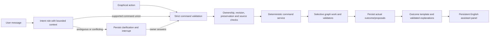

# Conversation and Validated Command Processing

## 1. One Domain Path for Chat and Controls

Graphical controls and conversational instructions enter the same command dispatcher. Chat adds an interpretation step; it does not create a second business-rule or booking system.



The BFF admits an operation before the asynchronous interpreter runs. An acknowledgment states that the request was received. After schema and semantic validation, the graph applies safe preference/search commands. It asks a clarification only for genuine ambiguity/conflict, not for every harmless change.

## 2. Request Envelopes

Implement a strict public request schema:

```typescript
type CommandInput =
  | { kind: "commands"; commands: DomainCommand[] }
  | { kind: "chat"; message: string };

interface CommandRequest {
  requestId: string;
  expectedRevision: number;
  input: CommandInput;
}
```

`commands` contains 1..4 compatible strict commands. Chat messages are 1..2000 trimmed characters. Neither envelope accepts model profile changes, confirmation flags, a foreign thread/operation ID, arbitrary execution targets, SQL, code, or tool definitions.

The public resume schema and decision-kind/action restrictions are defined in [domain contracts](04-domain-model.md). They use owner session, CSRF/origin, current revision, decision ID, and the worker's actual checkpoint/interrupt binding. Only an explicit booking review/confirmation response can commit a booking.

Commands emitted by a model are validated against a restricted conversational schema even though the broader deterministic dispatcher also supports protected demo controls. `set_simulation` cannot be smuggled into a chat result.

## 3. Interpretation Rules

| Request | Safe interpretation | Must not do |
| --- | --- | --- |
| "Find a cheaper hotel." | Search below current selected/confirmed party-total price, preserving that hotel's category | Automatically downgrade or replace it |
| "Find a cheaper hotel, but keep the flights and restaurants." | Same hotel search; preserve all named flight/meal refs and unaffected activities | Rebook flights, swap meals, regenerate the full scenario |
| "Change dinner to a luxury restaurant." | Set dinner override to luxury, show eligible alternatives, request selection/replacement confirmation | Change global level, breakfast, lunch, or confirmed dinner immediately |
| "Make the day less exhausting." | Propose lower pace/density/walking; preserve bookings and exact confirmed meal times | Interpret relaxed pace as parks only or silently remove required museums |
| "Add more museums." | Increase museum emphasis; if current museum count is known, store at least one more as an explicit minimum | Only change a prose summary with no structured target |
| "Add two more museums." | Persist absolute minimum `currentMuseumCount + 2` if <= 7 and feasible; otherwise clarify | Lose the number during compaction or ignore it during review |
| "A better hotel." | Ask whether location, rating, amenities/category, or value matters when context does not resolve it | Assume "better" means higher price/category |
| "Keep the flights but make the trip cheaper." | Search hotel/meals/free activity alternatives without committing replacements | Turn a price goal into cancellation of booked flights |
| "I'd rather visit a park than another museum." | Change activity requirement/selection proposal and rebuild the affected program, explaining exact substitution | Cancel a reservation or invent a new park |
| "Book it." | Open the existing valid selection's review, or clarify which service if there are several | Confirm solely from an LLM utterance |
| "Change Rome to Ceske Budejovice." | Preview incompatible reservation effects; after explicit approval, run fresh Stage A | Reuse Rome approval, offer a fake flight, or imply the city is unreachable by ground |

If there is no current price baseline, show a budget-cap clarification instead of pretending an offer is cheaper. If the effective preference has diverged from a booked hotel's level, preserve the booked category for relative searches unless the user explicitly asks for the target level.

Pace, interests, and explicit count requirements are independent. Six major museums with relaxed pace produces a conflict even if the interest weight favors culture. Explain time/physical constraints and offer practical choices, such as a relaxed two-museum plan or a denser feasible program; never promise six visits unless deterministic duration/travel validation supports them.

## 4. Canonical Examples

Actual offer IDs are looked up server-side; these examples do not authorize execution by themselves.

### Same-category hotel search

```json
{
  "kind": "commands",
  "commands": [
    { "type": "find_alternatives", "target": "hotel", "objective": "cheaper" }
  ],
  "preserve": ["flights", "breakfast", "lunch", "dinner", "activities", "events"],
  "interpretation": "Search for a lower-priced hotel in your currently selected category; keep the rest of the trip."
}
```

The comparator uses equal dates, nights, room allocation, and adults. A cheaper one-night price cannot replace a two-night booking by passing a simple numerical comparison.

### Two-target request

Assume the current itinerary has one museum:

```json
{
  "kind": "commands",
  "commands": [
    { "type": "find_alternatives", "target": "hotel", "objective": "cheaper" },
    { "type": "set_activity_requirement", "tag": "museum", "minimumCount": 3 }
  ],
  "preserve": ["flights", "breakfast", "lunch", "dinner"],
  "interpretation": "Look for a cheaper same-category hotel and propose an itinerary with at least three museums, keeping flights and meals."
}
```

Apply safe preference/search changes together, but do not confirm any booking in that transaction. Replan with the current confirmed hotel until the user accepts a replacement. If the activity minimum cannot fit, interrupt for a compromise; do not label the whole request complete because only hotel search succeeded.

### Service-level change

```json
{
  "kind": "commands",
  "commands": [
    { "type": "set_service_override", "service": "dinner", "level": "luxury" }
  ],
  "preserve": ["flights", "hotel", "breakfast", "lunch", "activities"],
  "interpretation": "Show luxury dinner alternatives without changing your existing reservation."
}
```

## 5. Clarification Contract

An `IntentResult` clarification contains a concise English question, original typed requested commands/preservation scope (not executed), and 2..4 alternatives. Each option has an opaque ID, label, and schema-validated command list checked against actual constraints. A six-museum target remains a typed pending request even while the alternatives propose lower counts.

Prepare a domain decision before `await_decision`. A click submits only the bound option ID. The worker resolves it to the stored command list, not a new list generated in the browser. A free-text follow-up is a new authorized chat operation routed through the current interrupt's internal `modify` branch.

Clarification examples:

- "Better hotel": location versus higher rating versus explicit luxury level.
- Six museums/relaxed: reduce museum minimum versus change pace and show the densest feasible alternative.
- No cheaper hotel in category: retain current hotel versus explicitly lower the target category versus choose a higher price cap.
- Budget below fixed reservation costs: raise budget versus review explicit replacements/cancellations; no fictional discount.
- Ground-preferred destination: choose another city/origin; ground travel is outside the flight planner but the rejection is not a claim of inaccessibility.

Choosing an option is not permission to confirm a later booking. Confirmation still has its own proposal, impact preview, disclaimer, source fingerprint, and explicit review action.

## 6. Context and Persistence

Conversation messages are stored by trip with a stable sequence and roles `user`, `assistant`, and `system_notice`. A message links to interpretation, operation, outcome, and relevant proposal/decision IDs. Do not store provider reasoning or raw unvalidated model output as an assistant message.

The compact context contains:

- Authoritative current route, date/variant, adults, default/overridden levels, pace/interests/count requirements, and budget.
- Selected/confirmed service IDs, categories, party prices, dates/times, and current itinerary activity counts.
- Pending proposal/decision kind and safe reason, latest structured outcome, and explicit preservation constraints.
- Deterministic summary of older resolved request/outcome IDs plus up to six recent messages, within [AI token limits](06-ai-agent-design.md).

Summary generation is deterministic from committed structured outcomes; no extra summarizer agent is needed. Preferences are never reconstructed from prose. Unresolved requests/conflicts must remain represented by IDs/typed pending decisions rather than disappearing from a summary.

Store the user's message on admission, an interpretation only after validation, and the assistant result only after the corresponding operation outcome is persisted. On duplicate `requestId`, reuse the original message/operation/result, not another conversation entry or LLM call.

## 7. Outcome Language

| Application state | Example response |
| --- | --- |
| Queued | "Your request has been received. No selections have changed yet." |
| Search succeeded | "I found three lower-priced luxury hotel alternatives. Your flights and meals are unchanged. Choose one to review a replacement." |
| Preference changed, booking retained | "Dinner now has a Luxury preference. Your existing Standard demo reservation remains confirmed until you approve a replacement." |
| Confirmed replacement committed | "Your new demo hotel reservation is confirmed. The previous demo reservation is marked superseded; flights and meals are unchanged." |
| Itinerary rebuilt but not approved | "A less demanding draft is ready for review. Your confirmed flights, hotel, and meals were preserved." |
| Provider error | "The simulated hotel provider failed. Restaurant and attraction results are saved; only the hotel search will be retried." |
| Route rejected | "This flight-based trip is not practical under the demo route rules. No flights were generated. You can change destination or origin; ground travel may still be possible." |
| Fixture mode | "This is a scripted fixture response. Use the listed demo requests or graphical controls." |

Personalize with the escaped first name when useful, not in every sentence. Do not say "booked", "changed", "ready", or "approved" before the corresponding deterministic commit/validation succeeds. Explain partial success, preserved components, outstanding decisions, warnings, and limitations explicitly.

## 8. Re-entrant Interaction

A completed graph is not kept permanently suspended. A new authorized request invokes the same trip thread with plain new-operation input, resets per-operation counters, hydrates current domain state, and applies the [invalidation matrix](03-langgraph-design.md#10-selective-invalidation-matrix).

If a decision is already pending, admit only supported answers/modifications. The worker resumes that exact interrupt with a typed internal modification reference, explicitly resolves/cancels the old decision, and routes into interpretation/command application. Do not run a second invocation beside it or erase a checkpoint manually.

A change that invalidates an earlier step (a pace or activity change after the hotel is confirmed, a rejected proposal) re-derives that step's decision instead of restarting the wizard, and a reselection keeps its explicit target: `change_hotel` reopens the hotel step even though the confirmed hotel would otherwise derive the program step, and `change_meals` reopens the program step (2026-10-13). Reopened decisions reuse the current offers/choices so the user only re-confirms what changed. The exceptions are the ACTIVITY-preference changes with an applied program — pace, interests, and numeric activity requirements (including a chat like "add one more museum"): the program is authoritative, so the affected attractions are refreshed and the day is replanned directly, and the user confirms it at the itinerary approval — never by re-saving the meals (2026-10-13/14, product decision).

If another operation is active, show a busy conflict and preserve the typed message/form. If the revision is stale, refresh and let the user resubmit deliberately. Do not automatically reinterpret/resubmit a previously rejected modification against changed state.

## 9. Acceptance

- UI dinner-level changes and the equivalent chat request produce the same preferences, affected-domain set, and preserved booking IDs.
- Same-category cheaper requests keep category and comparison basis after global preference changes.
- Numeric museum requirements survive summarization, browser refresh, restart, and planning review.
- Unknown/injected executable operations and foreign offer IDs are rejected before domain execution.
- An ambiguity executes no partial command before the clarification is answered.
- Multi-target results explain partial progress without claiming an unconfirmed replacement.
- New messages after final approval restart the graph correctly and remain on the owned trip.
- Fixture mode is visibly scripted; credentialed live mode uses the configured role and real validated model output.

See [tests](11-testing-strategy.md), [booking lifecycle](09-booking-simulation.md), and [Phase 08](phases/phase-08.md).
