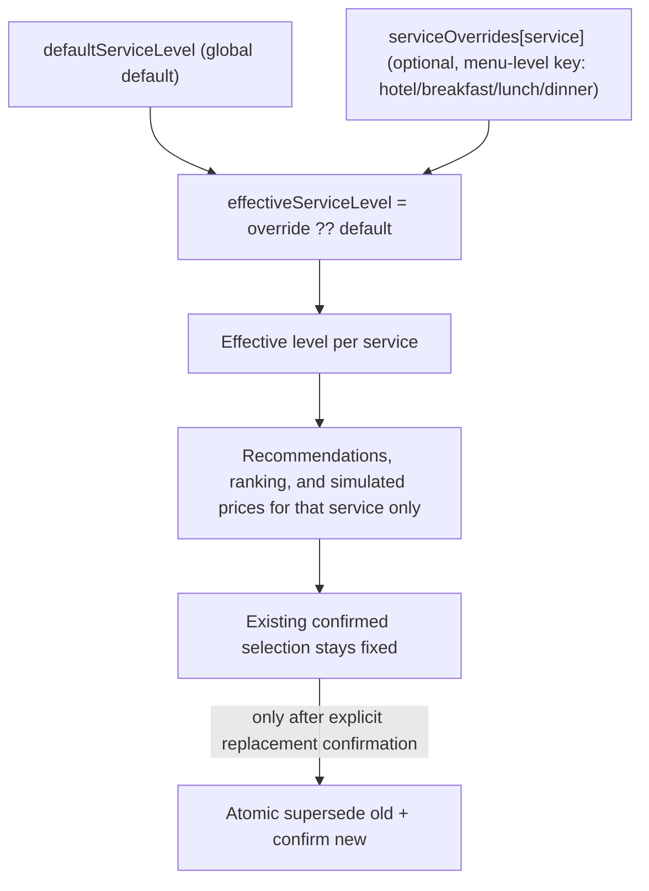

# Frontend UX Specification

This document is the authoritative home for the traveler UI, design system, pace presentation metrics, map policy, and inspector presentation. It specifies behavior for later implementation; it is not application code. Contracts, admission, graph behavior, and booking authorization are defined in [04 Domain Model](04-domain-model.md), [02 Architecture](02-architecture.md), [03 LangGraph](03-langgraph-design.md), and [09 Booking](09-booking-simulation.md); this document links to them instead of redefining them.

## 1. UI Principles

- English only. All labels, messages, disclaimers, and empty states are English.
- The interface is a hybrid: a full graphical wizard plus a persistent assistant. The assistant supplements the wizard; it never replaces graphical controls.
- The server projection is the only source of trip truth. A selected card is not a confirmed reservation; the UI never computes prices, feasibility, pace feasibility, or booking decisions client-side.
- A `202 Accepted` response means a command was queued, not completed. Completion is shown only after the operation status or SSE event reports success.
- No external font, CDN, analytics, or tile dependency is required for the core planning flow. The Roboto webfont is downloaded at build time and self-hosted via `next/font`; the browser makes no runtime font-CDN request.
- AI mode is visible: a quiet banner states whether the app runs in `OpenRouter` mode or `Deterministic fixture mode` (scripted responses; see [06 AI design](06-ai-agent-design.md)).

## 2. Visual System (travel journal)

Direction: a warm travel journal: cream paper, ink text, teal accent, restrained borders, and generous whitespace.

- Tailwind CSS 4.3.3 with CSS-first `@theme` tokens in a global stylesheet. No `tailwind.config.js`/`.js` file may exist. Component variants use plain CSS variables and utility classes.
- Headings: Georgia, `"Times New Roman"`, serif (`--font-serif`). Body/UI: Roboto webfont with system-sans fallback (`system-ui`, `-apple-system`, `"Segoe UI"`, `sans-serif`). Roboto is loaded with `next/font/google` in the root layout (`variable: "--font-roboto"` on `<html>`) and wired as the `--font-sans` token (`var(--font-roboto), …`); assets are self-hosted, so there is no runtime font CDN.
- Core tokens (fixed initial values; verify contrast in Phase 01, changing only a pair that demonstrably fails):

| Token                 | Role                             | Value     |
| --------------------- | -------------------------------- | --------- |
| `--color-cream`       | page background                  | `#FAF6EC` |
| `--color-paper`       | cards, sheets                    | `#FFFDF7` |
| `--color-ink`         | primary text                     | `#1F2A2E` |
| `--color-ink-muted`   | secondary text                   | `#566266` |
| `--color-teal`        | primary action/accent            | `#0E6B6B` |
| `--color-teal-strong` | hover/active, focus ring         | `#0A4F4F` |
| `--color-clay`        | warnings, simulated-failure tags | `#8A4B2A` |
| `--color-border`      | hairlines                        | `#D9D2C2` |

- Provenance labels are always text, not color alone: `Geographic reference`, `Demo offer`, `Simulated schedule/price`, `Approximate location`, `AI recommendation` (see [05 Synthetic data](05-synthetic-data-design.md)).
- Motion: only short fades/slides; `prefers-reduced-motion: reduce` disables non-essential animation.

## 3. Component Policy

- Native HTML first: `button`, `input`, `select`, `textarea`, `fieldset`, `details`, `summary`, `progress`.
- Radix primitives limited to Dialog, Popover, and Tabs for focus management. No component framework, generator, or icon pack; icons are inline SVG.
- Searchable selects use one small internal combobox component implementing the WAI-ARIA APG combobox/listbox pattern (roles, `aria-expanded`, `aria-activedescendant`, typeahead, Escape/Arrow/Enter handling). It is shared by country, city, and airport inputs.
- Tables (inspector, impact preview) use semantic `<table>` with `<caption>`; on mobile they become labeled definition lists, not horizontally scrolling traps.

## 4. Application Shell

- Header: product name `AI Travel Planner`, personalized `Hello, {firstName}`, trip status chip (`queued`, `running`, `waiting_user`, `blocked`, `ready`, `failed`), and a link to the inspector when demo controls are enabled.
- Permanent demo banner on every route, exact wording:

  **DEMO APPLICATION - No real reservations are made and no payments are processed.**

  The same string appears in the footer and in the booking confirmation dialog. Every confirmation additionally shows the exact sentence:

  **Simulated booking - not valid for travel, accommodation, or restaurant admission.**

  Both strings use the ASCII hyphen exactly as written; they are asserted verbatim by UI tests and are never translated or truncated.

- Desktop (>= 1024 px): wizard content (8/12) and a persistent assistant rail (4/12, 360-400 px). The map lives in a tab/section beside the timeline.
- Mobile (< 640 px): single column; the assistant collapses into a bottom sheet (Radix Dialog) opened from a sticky "Assistant" button; forms remain fully usable with one hand.
- Offline/error states: a small persistent status area shows queued operations, connection loss, and SSE reconnection via polling fallback (see [02 Architecture](02-architecture.md) section 8).

## 5. Wizard Steps

Routes below match the brief's Step 0-10. Welcome/country/city are a local draft before the first trip exists; once the trip exists the same two routes render its recorded values read-only, and the record is kept in the tab's `sessionStorage`, so a page reload (also after using the Trip steps links) still shows the created trip's values instead of an empty new-trip form — `Start a new trip` clears the record (2026-10-14). After Step 2, `POST /api/trips` receives the complete validated input and `requestId`; a creation request has no existing trip revision. Existing-trip writes use the command/resume routes with `requestId` and `expectedRevision`. All trip reads use the authorized projection. The UI's screen headers carry a shared step indicator, `Step N of 8`, over the eight user-facing screens (details, destination, flights, hotel, meals, activities, itinerary, summary), derived from the shared step list in `apps/web/src/lib/trip-step.ts` — the same order the sticky step navigation renders, so the captions cannot drift from each other or from the nav. The brief's Step 0-10 numbering is the planning reference for routes, never a header label (2026-10-14).

| Step            | Route                          | Content and required controls                                                                                                                                                                                                                                                                                                                     |
| --------------- | ------------------------------ | ------------------------------------------------------------------------------------------------------------------------------------------------------------------------------------------------------------------------------------------------------------------------------------------------------------------------------------------------- |
| 0 Welcome       | `/`                            | First name (1-60 chars), sightseeing date, origin airport combobox, adults 1-6 (default 1), Travel Variant cards, default Service Level segmented control, Activity Pace segmented control, optional budget (party total, EUR)                                                                                                                    |
| 1 Country       | `/destination` before creation | Country search over the admitted manifest with coverage note                                                                                                                                                                                                                                                                                      |
| 2 City          | `/destination` before creation | City/airport coverage; submit complete welcome+destination draft to create the trip. Later route edits happen in place on the trip (`set_route` from the flights route-fix card or the assistant), not by re-entering this step (2026-10-14).                                                                                                     |
| 3 Flights       | `/trips/[id]/flights`          | Flight combination cards: airline, demo flight number, airports, local+UTC times, duration, stops, total travel time, party-total EUR, variant compatibility badge; select then confirm (`Confirm simulated booking` / `I don't want to book`)                                                                                                    |
| 4 Hotel         | `/trips/[id]/hotel`            | Hotel cards: category, rating, nights, party-total EUR, center distance, approximate anchor; hotel quality control (override) inline; select then confirm (`Confirm simulated booking` / `I don't want to book`); a settled hotel (confirmed or kept) offers `Change hotel`, which re-opens the refreshed choice (2026-10-14)                     |
| 5 Meals         | `/trips/[id]/meals`            | Breakfast/lunch/dinner cards with per-meal level control; optional simulated reservation per meal; the saved program offers a per-meal `Change <meal>` action that re-opens the program choices with the refreshed offers (2026-10-14)                                                                                                            |
| 6 Activities    | `/trips/[id]/activities`       | Culture/Relaxation/Entertainment groups, interest sliders, pace display, tag filters, active requirement chips, live visit-time budget; visits are OPT-IN (2026-10-14) — the plan contains only pinned activities plus what satisfies the requirements, and the step states what the current plan already contains and marks planned/pinned cards |
| 7-8 Itinerary   | `/trips/[id]/itinerary`        | Chronological timeline (meals, activities, breaks, transfers, buffers), validator errors/warnings, review notes, approval action; cost rows of an unbooked kept flight/hotel carry a `Not booked` badge                                                                                                                                           |
| 9 Modifications | any route + assistant          | Same command schemas as the assistant; selective change previews                                                                                                                                                                                                                                                                                  |
| 10 Summary      | `/trips/[id]/summary`          | Name, destination, dates, flights, hotel, meals, activities, timeline, map, party-total estimate, demo references, trip notes; `Not booked` selections with a booking action; stays editable through the assistant                                                                                                                                |
| Inspector       | `/trips/[id]/inspector`        | Execution panel; see section 9                                                                                                                                                                                                                                                                                                                    |

Wizard rules:

- Infeasible or undetermined route results render a structured decision card with reason codes, plain explanation, and alternatives (`change origin`, `change destination`, `choose ground travel elsewhere`); the wizard does not advance and never displays fabricated flights.
- Welcome cards collect a provisional variant while availability is unknown. Economy availability requires its own passing StageB; a no-offer result explains the limit and offers an explicit variant change with fresh StageA. Never use another variant's approval to generate alternatives.
- Dinner controls show `Not included - no feasible slot before your return flight` only for the deterministic nullable-dinner result. Breakfast/lunch stay required and an existing confirmed dinner is never silently removed.
- Flight and hotel bookings are optional (`I don't want to book`, 2026-10-14): the step then shows the kept offer with a `Not booked` badge and a `Book this flight`/`Book this hotel` action; the day plan keeps the flight times, airport buffer, hotel anchor, and the flight/hotel cost rows, and the summary marks the selection `Not booked`. The hotel step unlocks after a confirmed OR kept-selection flight, and the meals step after a confirmed OR kept-selection hotel; booking a kept selection later goes through the ordinary review/confirmation dialog and replans the itinerary. A settled hotel/meals step also offers a change action — `Change hotel` and a per-meal `Change <meal>` — that stages the same `find_alternatives` command the summary and the assistant use and re-opens that step's choice (the hotel offers or the program choices with the refreshed meal offers); a kept selection or an existing reservation is only replaced through the ordinary review/confirmation (or replacement confirmation) flow (2026-10-14).
- Changing country/city/date/variant submits a safe proposal request first; the server's impact preview is shown before confirmation. Incompatible reservations are listed for explicit cancellation approval (see [09 Booking](09-booking-simulation.md) section 7).
- Every step renders from the last projection; after `409 STALE_REVISION` the UI refreshes and re-presents the current revision instead of replaying the old command.
- The activities step stays editable while the itinerary approval (or a clarification) is pending: pace, "I'll arrange the activities myself", the activity choices and Save submit `set_activity_pace`/`set_program` commands, which the worker applies as internal modifications — saving replaces the pending decision and replans the day, and the page says so. Activity PACE, interest, and numeric-requirement changes do not reopen the meals step: with an applied program they refresh the affected attractions and replan directly into a fresh approval (2026-10-13/14). The meals and hotel steps follow the same editability rule (2026-10-14): their `Change <meal>`/`Change hotel` actions stay live while the itinerary approval or a clarification is pending (the change is admitted as a modification, replaces the pending decision, and replans); the saved meals view itself shows no per-meal level selects (2026-10-15) — a `Change <meal>` reopens the program choices, where the meal's category select lives — while read-only stays for decisions the user answers elsewhere (meal program choice, staged booking confirmations, flight/hotel choices, recovery).
- A `recovery` decision offers only the steps it can reopen, and choosing one navigates to that step's page (`change_hotel` → `/hotel`, `change_meals` → `/meals`); a research-failure `change_program` ends the run on the affected page, which shows its own failed/retry state. The decision pages render the recovery card instead of a dead decision whenever `recoveryRequired` or `workflow_status = failed`, and its Retry targets the recorded unfinished operation (never a newer rejected conflict row), after which the card explains that only the unfinished work re-runs.

## 6. Preference Controls and Inheritance

- Effective level is `serviceOverrides[key] ?? defaultServiceLevel` ([04 Domain Model](04-domain-model.md) section 2). The UI distinguishes the two states with a chip and helper text: `Inherited from trip default (Standard)` versus `Explicit override: Luxury`.
- Setting a control to `Inherit default` clears the override (`set_service_override` with `level: null`); it never mutates the global default.
- Changing the global default updates only services that are inherited. Confirmed selections are never silently replaced; alternatives are proposed and require explicit confirmation.
- Hotel screen shortcut: the hotel quality control writes the hotel override, not the global default.

- Numeric activity requirements: a relative request such as `two more museums` is converted by the intent layer into an absolute `set_activity_requirement` (`tag`, `minimumCount` 1..7; `null` clears it) computed from the current actual activity tags ([04 Domain Model](04-domain-model.md) section 6, [07 Conversation and intents](07-conversation-and-intents.md)). Each requirement renders as a chip (`Minimum 4 museum visits`) with a clear action (Remove), is shown as a constraint in the activity step and itinerary review, and is preserved unless the user changes it. The activity step also states what the CURRENT plan already contains (`In your current plan: N visits · X visit minutes — <name> (hh:mm–hh:mm), …`) and attributes every planned visit on the matching catalog card — `Planner pick · hh:mm–hh:mm` versus `Pinned by you · hh:mm–hh:mm` — so the user can tell the assistant's picks (visits planned because a requirement asked for them — never opportunistic extras: visits are opt-in since 2026-10-14) from their own selections and never re-picks a visit that is already planned; the plan state, the selection feedback, Save, and "Continue to the itinerary" sit in a sticky bottom status bar so they stay visible while the catalog scrolls (2026-10-14), and the step speaks in human sentences, never calculator output: it either explains that no visits are planned yet (free time apart from fixed meals/transfers), summarizes the current plan in hours ("4 visits · about 5 h 40 min (2 museums, 2 landmarks) — Didrichsen Art Museum (09:00–10:50), …"), or, for a pending selection, distinguishes pins of visits the plan ALREADY contains ("Everything you selected is already part of the plan — pinning keeps it in the day (nothing is added twice)") from genuinely new ones ("Pinning adds N new visits, about X h — your full selection stays within the N h visit budget of a <pace> day"); when a pending selection would exceed the pace cap it shows an over-budget alert with a concrete remedy ("Remove a visit or lower the requirement, then save") and disables Save. A requirement that conflicts with pace or available time is clarified with concrete options; it is never silently dropped, and the "cheapest" style of relative change never mutates requirements or unrelated categories.

## 7. Activity Pace (authoritative presentation metrics)

Pace controls intensity, never category. A relaxed itinerary may be all museums; an intensive itinerary may be all parks. Targets are guidelines; duration templates and feasibility override raw counts. Metric names below are the values the deterministic planner and validator use (see [03 LangGraph](03-langgraph-design.md) section 4 and [05 Synthetic data](05-synthetic-data-design.md) section 9).

| Metric                                                                   | Relaxed                                              | Moderate                       | Intensive                            |
| ------------------------------------------------------------------------ | ---------------------------------------------------- | ------------------------------ | ------------------------------------ |
| Target major activities (guideline only — visits are opt-in, 2026-10-14) | 2-3                                                  | 3-5                            | 5-7                                  |
| Daily activity-visit time cap (sum of visit durations)                   | 240 min                                              | 360 min                        | 480 min                              |
| Rhythm break                                                             | 20 min seated after each activity                    | 10-15 min every ~2 h           | 5-10 min as needed                   |
| Long break                                                               | one 60-90 min block                                  | one 30-45 min block            | optional                             |
| Breakfast / lunch / dinner duration                                      | 60 / 90 / 120 min                                    | 45 / 60 / 90 min               | 30 / 45 / 60 min                     |
| Estimated walking cap                                                    | 4 km/day, 1 km/leg                                   | 7 km/day, 1.5 km/leg           | 10 km/day, 2 km/leg                  |
| Minimum inter-event transfer buffer                                      | +20 min                                              | +15 min                        | +10 min                              |
| Physical-demand tolerance                                                | no high-demand legs; avoid consecutive moderate legs | short high-demand legs allowed | high-demand legs allowed if feasible |

- Duration override: a long activity consumes the cap; e.g., two 120-minute museums fit relaxed but seven museums do not fit any pace. Seven 20-minute exterior landmarks fit intensive; six major museums at relaxed pace is a conflict, never silently reduced.
- Luxury meals use the same meal-duration floor plus up to +15 min; confirmed reservation times are fixed and never moved to make pace fit.
- Fixed airport buffers and Stage B schedule windows override pace buffers. Pace never weakens feasibility checks.
- Existing confirmed meal durations are fixed; pace meal durations are defaults for unbooked slots, not permission to extend/move a booking. Compensate with other breaks where feasible, otherwise clarify.
- Conflict UX: explain visit time versus cap and offer only supported feasible options such as reducing the minimum count, changing pace, or choosing genuinely shorter available visits. Do not offer an unsupported multi-day extension or promise six major museums merely by increasing pace. A packing exhaustion (the visits cannot fit around the fixed meal times, transfers, and opening windows) offers a denser-pace replan when a denser pace exists, a bounded reduction of a tag minimum the plan actually met, and the manual review path — never the generic recovery card, which cannot free any room (2026-10-14).
- Live budget on the activities step (2026-10-13): the server computes the selected visit minutes against the pace cap (`activityVisitBudget`, exposed read-only as `GET /api/trips/[id]/activity-fit?ids=…`; the UI never derives pace feasibility itself). The step shows `N selected · X of Y visit minutes (pace target a-b)` and, when the cap is exceeded, the alert `Your selected activities do not fit the available time (X of Y visit minutes; Z over). Remove one or more of the selected activities.` with Save disabled until the selection fits. Self-arranged activities skip the check (no sightseeing stops); the planner/validator still own full day feasibility.

## 8. Persistent Assistant

- The conversation rail is always reachable; history renders persisted `conversation_messages` with roles and timestamps.
- Each interpreted request shows a structured interpretation card: detected intent, affected services, preserved services (including `activities`/`events` when the user asks to keep them), numeric activity requirements, and the current status (`Accepted`, `Working`, `Waiting for your decision`, `Succeeded`, `Failed`, `Blocked`). Interpretation and command schemas come from [07 Conversation and intents](07-conversation-and-intents.md).
- The assistant must not claim completion before the operation confirms it; wording distinguishes a search proposal from a completed replacement or confirmation.
- Ambiguity/conflict produces a clarification with named options, rendered as buttons plus free text.
- User text is rendered as plain text (1-2000 chars); no raw HTML, links, or code execution.

## 9. Map

- Leaflet 1.9.4 as a direct dependency in one client-only component (`dynamic(..., { ssr: false })`), with plain Leaflet (no wrapper library). Markers: airports, hotel, meals, and activities with provenance/approximate badges.
- If tiles are configured, initial source is OSM standard `https://tile.openstreetmap.org/{z}/{x}/{y}.png` with visible `Copyright OpenStreetMap contributors` attribution/link and GeoNames/ODbL data credits. The browser sends Referer automatically. Tile URLs are necessarily public and may not contain server secrets.
- Tile policy compliance: rely on normal HTTP caching (no cache-busting parameters), never prefetch/preload offscreen tiles, never bulk-download or offer offline tile packs, and keep demo traffic within the provider's acceptable-use policy. `MAP_TILE_URL` may point only to a policy-compliant source with required attribution; otherwise the app runs with the fallback.
- Graceful offline fallback: if no initial tile loads within 5 seconds, repeated tile failures occur, or no URL is configured, render a static SVG schematic with markers and dashed links labeled `Approximate simulated connections`. Include a manual fallback action; no road-navigation claim. All locations remain reachable as an accessible list.
- The map is supplementary. Every map fact (names, approximate positioning, simulated transfer times) is also available as text; distances/times are always labeled simulated estimates.

## 10. Inspector

- Route `/trips/[id]/inspector`, same session/ownership checks. Live updates use SSE with polling fallback.
- Displayed: node inventory and statuses (active, completed, pending, interrupted, failed), retry attempts, checkpoint IDs, resume operations, execution durations, LLM call rows (role, model, prompt version label, tokens, estimated cost, validation status, retries), current scenario mode, and injected faults labeled `Simulated failure`.
- Render an actual node/edge SVG execution graph, not only a log/list. The worker emits a safe versioned `graph.initialized` definition from the same registry used to build nodes/edges/conditional paths; persist that event and expose it through the projection. Node/task highlights and branch labels come from real execution events. The BFF does not invoke graph APIs or expose compiled nodes; the client imports only the strict public definition DTO.
- Forbidden: prompts, chain-of-thought or any raw model reasoning, provider payloads, SQL, stack traces, cookies, secrets, raw headers. The inspector renders only safe projected event fields ([02 Architecture](02-architecture.md) section 8, [10 Security](10-security-reliability.md)).
- Simulation controls (`set_simulation`) appear only when `DEMO_CONTROLS_ENABLED`, are visibly demo-only, and submit through the same validated command endpoint. A restart/browser-close recipe is shown as instructions the user performs; the browser never executes server shell commands.

## 11. Accessibility (WCAG 2.2 AA)

- Keyboard-complete: every action, including map marker details and decision dialogs, is operable without a pointer and in logical order; skip link to content.
- Focus visible and unobscured on all controls (AA SC 2.4.7/2.4.11); restore it after dialogs close. Aim additionally for AAA 2.4.13 focus appearance; do not mislabel it as AA.
- Forms: persistent visible labels, programmatically associated help/error text, error summary at the top of the form, no loss of input on error; no CAPTCHA or cognitive test (SC 3.3.8).
- Combobox follows the APG pattern and announces result counts via `aria-live="polite"`.
- Dialogs (booking confirmation, replacement preview, route-change impact) use Radix Dialog with labelled title/description, Escape to close, and a visible cancel path.
- Announcements: polite live region for status changes, assertive for errors; booking/decision outcomes are announced once with the demo reference.
- Target size >= 24 px (SC 2.5.8); dragging is never required (SC 2.5.7); consistent help link in the footer (SC 3.2.6).
- Contrast: >= 4.5:1 body text, >= 3:1 large text and meaningful UI boundaries. The light border token is decorative only; input/focus/status boundaries use a sufficiently contrasting ink/teal token.
- `prefers-reduced-motion` support; no content flashes more than three times per second.

## 12. Responsive Behavior

| Breakpoint  | Layout                                                                                                                     |
| ----------- | -------------------------------------------------------------------------------------------------------------------------- |
| < 640 px    | Single column; assistant bottom sheet; map collapsed behind "Show map"; stepper horizontal scroll with sticky current step |
| 640-1023 px | Single column with wider cards; assistant still a sheet; timeline vertical                                                 |
| >= 1024 px  | Wizard + assistant rail; timeline and map side-by-side tabs; inspector as a full-width route                               |

Dates render in the destination IANA zone with an explicit zone label; money renders as EUR with an explicit `Total for N adults` label. Number/date formatting uses `Intl` with one documented locale configuration so tests are stable.

## 13. Timeline and Event Rendering

The itinerary timeline renders the immutable itinerary version from the projection; event contracts are owned by [04 Domain Model](04-domain-model.md) section 8.

- Ordering by UTC instant, display in the destination IANA zone with an explicit zone label; local date transitions (overnight) are visible.
- Event kinds: `meal`, `activity`, `break`, `transfer`, `airport_buffer`, `free_time`. Each card shows start-end, duration, location/provenance label, physical-demand classification, and whether the cost is included in the party total.
- Confirmed reservations, airport buffers, and fixed flight windows carry a lock badge explaining that changing them requires a replacement proposal.
- Validation errors and warnings anchor to their affected events, with an inline message plus a summary list at the top; the approval action stays disabled while errors exist.
- Draft versus approved is explicit: `Draft` badge until `itinerary_approval` succeeds, then `Approved`; later modifications create a new draft version without mutating the approved one.
- Map and timeline stay linked: selecting a card highlights the marker and vice versa; neither is required to operate the other.
- Per-event actions: `Change` (opens the matching service search/proposal), `Ask assistant` (prefills chat with the event context), or nothing for `break`/`free_time` beyond pace adjustments.

## 14. State, Empty, and Error Presentation

| Status                | Presentation                                                                                                            |
| --------------------- | ----------------------------------------------------------------------------------------------------------------------- |
| `idle` / no operation | Normal screens; submit buttons enabled                                                                                  |
| `queued` (after 202)  | Persistent inline `Accepted - planning in progress` banner with operation ID; submit buttons disabled for the same trip |
| `running`             | Same banner with live step label from SSE events; no spinner-only screens                                               |
| `waiting_user`        | Decision card or modal; the assistant input accepts clarification text                                                  |
| `blocked`             | Reason card with machine-readable code plus plain explanation and allowed alternatives; no dead end                     |
| `ready`               | Summary/approval surfaces enabled                                                                                       |
| `failed`              | Typed error with `retryable` flag; retry action only when the operation is retryable and within bounds                  |

- Loading uses skeletons that preserve layout; the UI never renders fake offer cards or placeholder prices.
- A user-initiated client request gets a full-screen operation preloader only after it has remained pending for 500 ms. The preloader names the current action in English, leaves focus where it was, and is announced through a polite live region; it is not a completion signal for the asynchronously queued worker operation, which remains represented by the status panel above.
- Unsaved form edits (welcome form, active filters) survive in-session navigation only and are never treated as trip truth.
- Empty states: no matching countries/cities, no offers after filters, missing reference coverage, and "verified landmarks unavailable" all explain dataset limitations and offer a next action (broaden filters or pick a curated city).
- SSE disconnection shows a reconnecting banner and falls back to polling; the last successful projection remains readable.
- Simulated failures are always labeled `Simulated failure` and never presented as real incidents.

## 15. UI Acceptance Hooks

- Playwright drives the full wizard, keyboard-only flows, stale-revision conflict, decision dialogs, offline map fallback, and inspector redaction.
- Verbatim string assertions cover both disclaimer sentences on all routes and every confirmation.
- Tests never assert real availability, real routes, or completion on a `202` response. Cross-references: [11 Testing](11-testing-strategy.md), [12 Roadmap](12-implementation-roadmap.md).

## Persistent assistant - voice extension addendum (2026-10-15)

Extends section 8 with the implemented voice controls (plan: [`../../VOICE_CONTROLL.md`](../../VOICE_CONTROLL.md) sections 10-12; tests: `tests/e2e/voice-control.spec.ts`).

- **Exact English helper.** "Use your microphone and speakers/headphones to control the assistant." renders as the immediate next help element below Send (`id="assistant-voice-help"`, referenced by the controls section via `aria-describedby`) on desktop and mobile.
- **Controls and order (inside the existing form, never replacing it).** textarea -> _Dictate_ / _Stop recording_ (one toggle button, `aria-pressed`) plus _Cancel dictation_ while capturing -> _Read replies aloud_ checkbox -> _Stop speaking_ while generating/playing and _Play reply_ when a decoded buffer waits for a gesture -> live status (`role="status"`) and errors (`role="alert"`) -> _Send_ -> helper. Every voice button is `type="button"` and can never submit the form.
- **First-use activation and preference.** The first explicit _Dictate_ enables voice and "Read replies aloud" for the tab; later dictation never silently re-enables replies the user turned off. The checkbox alone can enable replies for typed messages without microphone access. The privacy notice states the OpenRouter use and the activation behavior before first use.
- **Permission, privacy, and unsupported states.** Permission denied, no device, and unsupported browsers show the exact section-12 copy and keep typed chat usable; voice is disabled server-side shows the disabled copy; an invalid live configuration is an explicit voice-only 503.
- **Limits and completion.** A 2 000 ms speech pause ends dictation automatically after valid speech (initial silence and shorter pauses never do); _Stop recording_ is always available; the hard 60-second cap remains effective in manual mode (discarding speechless recordings with zero STT). A longer pause may split the question - edit the draft or dictate more before sending; automatic completion never sends.
- **Autoplay fallback and stopping.** Playback starts in a user gesture; if the context stays suspended the decoded reply is kept and _Play reply_ is offered. _Stop speaking_ aborts generation/playback without aborting a transcription; cancellation, replies-off, trip change, and unmount stop tracks and sources and discard pending work.
- **Desktop/mobile and accessibility acceptance.** Keyboard access, newest-first history, fixed scroll height, card rendering, and mobile layout are preserved; the E2E matrix (T-E2E-VOICE-01..12) asserts selectors, helper order, no auto-Send, manual and VAD insertion, spoken-reply selection, and cleanup on both Chromium projects.
