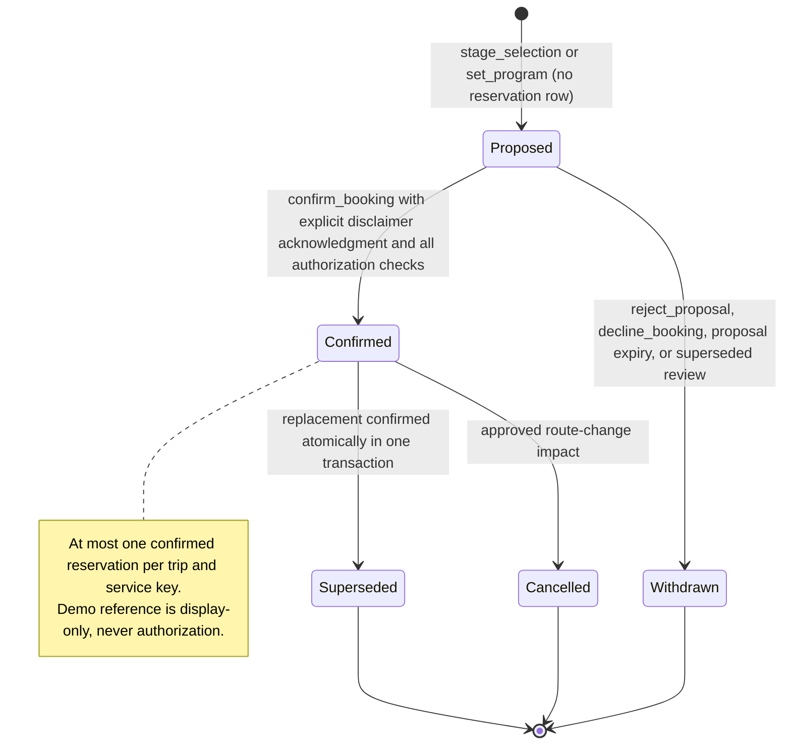

# Simulated Booking Specification

This document is the authoritative home for the internal demo reservation lifecycle, confirmation and replacement semantics, demo reference generation, and booking UI behavior. It is a specification only. Contracts live in [04 Domain Model](04-domain-model.md); admission and the effect ledger live in [02 Architecture](02-architecture.md) and [03 LangGraph](03-langgraph-design.md); presentation patterns live in [08 Frontend UX](08-frontend-ux.md).

## 1. Scope and Non-negotiables

- Reservations are internal demo records only: no real inventory, no provider call, no payment field, no payment endpoint, no payment UI.
- The permanent disclaimer and confirmation sentence are exact strings (ASCII hyphen):

  **DEMO APPLICATION - No real reservations are made and no payments are processed.**

  **Simulated booking - not valid for travel, accommodation, or restaurant admission.**

- Booking writes are executed exclusively by the deterministic booking service (Repository/domain layer). LLM output may propose a selection; it can never confirm, cancel, or replace a reservation, and a model message saying "confirmed" has no authority ([04 Domain Model](04-domain-model.md) section 6-section 7).
- Order of implementation (confirmed sequencing): the deterministic domain/persistence service and booking SQL constraints ship in Phase 03; the flight booking UI is introduced in Phase 06; hotel/meal selection and confirmation UI ship in Phase 07. [12 Roadmap](12-implementation-roadmap.md) is the gate authority.
- A handler `202 Accepted` response reports only that the command was queued; the UI shows success only after the operation outcome or SSE event confirms it ([02 Architecture](02-architecture.md) section 8).

## 2. Bookable Services and Data

| Service key | Offer source | Notes |
| --- | --- | --- |
| `flights` | One flight combination (outbound + return legs) | Requires current Stage A + Stage B validation; party-total EUR; optional booking - the chosen combination stays a selection when the user declines (`decline_booking`, 2026-10-14) |
| `hotel` | One hotel offer | Nights derived from travel variant; luggage storage required for `one_night`; optional booking - the chosen offer stays a selection when declined |
| `breakfast` | One restaurant offer | Optional reservation; selection may exist without booking |
| `lunch` | One restaurant offer | Optional reservation |
| `dinner` | One restaurant offer | Optional reservation |

A declined flight/hotel booking (`decline_booking`) persists the chosen offer in `trip_selections` exactly like an unbooked meal: no reservation exists, but the plan, its costs, the airport buffer, and the hotel anchor are computed as if the service existed, and the overviews mark it `Not booked` with a later booking action.

Booking implications by travel variant (destination-local dates, `D` = sightseeing date):

| Variant | Hotel check-in -> checkout | Nights | Return departure window |
| --- | --- | --- | --- |
| `one_night` | D-1 -> D | 1 | Late on D after required activities + transfer + 120-minute departure buffer; hotel luggage storage required |
| `two_nights` | D-1 -> D+1 | 2 | Day D+1 after the feasible checkout/transfer window |

Each offer referenced by a booking is an immutable snapshot record with `scenarioSnapshotId`, `domainVersion`, `synthetic: true`, and a party-total price in EUR ([04 Domain Model](04-domain-model.md) section 5, [05 Synthetic data](05-synthetic-data-design.md) section 7). An ID supplied by chat is only a reference to an existing authorized offer, re-checked at confirmation.

Reservation row (authoritative fields, see [04 Domain Model](04-domain-model.md) section 9): trip, service key, offer/snapshot refs, status, terms hash, `demoReference` (unique), confirmation key (unique), created/updated timestamps, and links to the proposal and confirming decision. History is append-only: rows are never deleted by route changes or replacements.

The confirmation record also stores an immutable terms snapshot: scenario/snapshot ID and offer content hash, service dates/nights, party size, party-total EUR, the demo labels shown to the user, and the disclaimer acknowledgement. Reads render from this record; nothing is re-priced or re-derived from a mutable later preference. There are no renewal, expiry, or payment terms.

## 3. Demo Reference Generation

- Format: `DEMO-FLT-` / `DEMO-HTL-` / `DEMO-RST-` plus 20 uppercase hex characters = 80 random bits (`crypto.randomBytes(10).toString("hex").toUpperCase()`). The brief's eight-X suffix is illustrative, not a length constraint.
- The suffix is generated by the booking service, never by the model and never by the client.
- Global SQL uniqueness is mandatory. On the reference-specific unique violation, roll back to a savepoint and regenerate, at most 3 attempts. Other unique violations are not treated as reference collisions. Exhaustion rolls back the whole transaction with `REF_GENERATION_FAILED`, leaving the old reservation intact.
- A demo reference is a display identifier only. It is never authorization, never a bearer secret, and cannot be used to read or mutate a booking.

## 4. Lifecycle

State meanings:

- `Proposed`: a `selection_proposals` record; no reservation exists yet and any previous booking stays active. `Withdrawn` is presentation for rejected/expired/superseded proposals, not a reservation-table state. `decline_booking` withdraws the proposal as rejected AND persists the offer as a `trip_selections` row (flight/hotel only): the selection survives the declined booking and can be booked later.
- `Confirmed`: an active reservation row created transactionally; one per trip/service.
- `Superseded` / `Cancelled`: terminal history rows with reason, decision ID, and timestamp.

## 5. Proposal Flow (Before Any Booking)

1. The user selects or asks for an alternative through a validated command (`propose_selection`, `set_program`, `find_alternatives`) or after a decision.
2. The graph node `stage_selection` creates the proposal: exact offer refs, dates/nights, party total in EUR, price delta versus the current selection, expiry, and an impact preview listing what would be superseded, cancelled, or revalidated.
3. The impact preview is deterministic and complete: hotel replacement lists affected transfers and itinerary slots; flight change lists hotel-date, transfer, sightseeing-window, and meal-impact checks; route change lists every incompatible reservation for cancellation approval.
4. Nothing is confirmed. Budget overage (party total versus `maxBudgetMinor`) is shown as a warning on the proposal; it never triggers an automatic downgrade or replacement.
5. Cheaper-search semantics: `find_alternatives: cheaper` compares against the selected/confirmed party-total price and preserves that offer's category unless the user explicitly supplies `level`. A global default changed after booking never implies a category downgrade; the proposal states the preserved category and the price baseline it used.
6. Proposals expire (default 30 minutes, configurable) or are withdrawn on rejection, superseding review, or route change. An expired proposal resolves to `Withdrawn`; the previous selection/reservation stays active and a new proposal is required.

## 6. Confirmation Flow (One Transaction)

Resume requests carry `PublicDecisionResponse`; the worker adds the trusted `GraphResumeEnvelope` operation identity/revision before invocation. Authorization uses owner session, origin/CSRF, revision, exact decision/checkpoint binding, proposal state, and fingerprint. Public callers cannot provide the internal `modify` action. See [domain contract](04-domain-model.md#7-decisions-and-resume).

The deterministic service then performs, in order:

1. Check the same admitted operation/effect result first; an identical recovery returns it even if that operation already resolved the decision. This never admits a new request.
2. For a new confirmation, validate ownership, accepted revision, proposal expiry, decision kind, exact binding, and disclaimer acknowledgment under the trip writer.
3. Re-check offer membership, dates/party/price, current route/schedule approvals, exact hotel/meal logistics, and that services have not already started.
4. Return the existing active reservation for the same offer if applicable, without creating another reference.
5. For an approved replacement, update the old row to `superseded` BEFORE inserting the new confirmed row: PostgreSQL partial unique indexes are checked immediately, not deferred to commit.
6. Generate the reference with savepoint-bounded collision handling and insert the new row. Any failure rolls back both changes, keeping the old row active.
7. Persist confirmation/effect result, selection and proposal/decision lifecycle updates, and event in the same domain transaction.

If the transaction commits and the checkpoint write then fails, recovery replays `commit_booking`: the effect key returns the stored result and the reservation is not duplicated ([02 Architecture](02-architecture.md) section 7, [03 LangGraph](03-langgraph-design.md) section 8).

| Check at confirmation | Failure behavior |
| --- | --- |
| Session, ownership, CSRF, exact origin | 403/404 envelope; no state change |
| Revision mismatch | `409 STALE_REVISION`; UI refreshes and does not replay |
| Decision missing, resolved, wrong kind, or foreign | `409 STALE_DECISION` |
| Proposal absent, expired, or withdrawn | `409 STALE_DECISION` or `PROPOSAL_EXPIRED` |
| Offer not in current snapshot; availability fails | `OFFER_UNAVAILABLE`; proposal withdrawn |
| Party size, dates, nights, or variant mismatch | `OFFER_MISMATCH`; proposal withdrawn |
| Disclaimer not acknowledged | `DISCLAIMER_REQUIRED` |
| Same-offer active reservation already exists | Idempotent success; existing reference returned |
| Different-offer active reservation, replacement not approved | `REPLACEMENT_CONFIRMATION_REQUIRED` |

All failures use the standard safe error envelope ([10 Security](10-security-reliability.md) section 9) and never render a success state or demo reference.

Decision-kind mapping: `flight_choice`/`hotel_choice` accept `choose_offer`, which stages a proposal (no booking); `booking_confirmation` accepts `confirm_booking`, `reject_proposal`, and - for flights/hotel - `decline_booking` ("I don't want to book": keep the offer as the step's selection, no reservation, the plan is unchanged and the service can be booked later); `replacement_confirmation` accepts `confirm_booking`/`reject_proposal`; `route_change_confirmation` accepts `confirm_route_change`; meals selected through `program_choices`/`submit_program` are confirmed later through per-meal `booking_confirmation`. `approve_itinerary` never creates a reservation. A response whose action does not match the pending kind is rejected as stale.

No-payment enforcement is structural: no payment module, dependency, endpoint, credential, or schema field exists anywhere in the repository; the booking service cannot construct a payment intent; an invariant test asserts this absence.

## 7. Replacement, Cancellation, and Route Change

- Replacement is atomic: `UPDATE old SET status='superseded'` and `INSERT new SET status='confirmed'` in one transaction; the partial unique index remains satisfied at commit time. If the user has not confirmed, the old reservation is untouched.
- Unrelated services are preserved: replacing a hotel preserves flights and all meal selections/reservations; replacing dinner preserves breakfast, lunch, hotel, flights, and activities; content hashes for untouched domains do not change ([03 LangGraph](03-langgraph-design.md) section 10).
- Meal replacement preserves adjacent itinerary slots except the affected one; the itinerary is revalidated for that slot and safety ([03 LangGraph](03-langgraph-design.md) section 10).
- `cancelled` is reached through explicit approved route-change impact. Standalone cancellation UI/API is not part of this POC; dismissing a proposal never cancels an existing reservation.
- Route changes (origin, city, date, variant) require an impact preview and a `route_change_confirmation` decision naming the affected reservation IDs to cancel/supersede. Confirmed bookings are never silently transferred to the new city. After approval, affected reservations are superseded/cancelled atomically and both feasibility stages rerun; route rejection produces no booking.
- All replacements/cancellations are user-initiated decisions; the assistant may prepare the proposal and explain it, but it cannot execute it.
- Preserved scope is explicit: the proposal and the accepted intent carry the preserved keys (`flights`, `hotel`, `breakfast`, `lunch`, `dinner`, `activities`, `events`); the confirming transaction asserts that every preserved service's selection/reservation row and content hash are unchanged.

## 8. Idempotency and Concurrency

| Mechanism | Key / rule |
| --- | --- |
| Request deduplication | Unique `(trip_id, request_id)` in `workflow_operations`; same payload hash returns the stored result, different payload is rejected |
| Effect replay | Unique `(operation_id, node_name, effect_scope)` in `workflow_effects`; replay returns stored result |
| Booking confirmation | Unique confirmation key tied to the resolved decision + proposal; repeated confirms return the active reservation |
| Active reservation invariant | Partial unique index: one `confirmed` row per `(trip_id, service_key)` |
| Demo reference | Unique index plus bounded regeneration |
| Concurrent browsers | At most one queued/running operation per trip; same-revision conflicts yield one winner and `409 STALE_REVISION` / `409 OPERATION_IN_PROGRESS` for the loser |
| Worker safety | Advisory-lock single trip writer, lease + fencing token, commit-before-checkpoint replay |

Every repeated confirmation, LangGraph retry, or operation recovery must produce the same stored outcome (brief Scenario M). Concurrent conflicting modifications produce a deterministic winner and no mixed state (brief Scenario N).

## 9. Fault and Recovery Windows

| Window | Expected behavior |
| --- | --- |
| Commit succeeds, checkpoint write fails | Replay `commit_booking`; effect key returns stored result; exactly one active reservation |
| Worker crashes mid-confirmation | Lease expires; next claimant recovers the same thread; unfinished nodes rerun idempotently |
| Browser closes while awaiting booking decision | Pending decision and interrupt binding reload; exact descriptor is re-presented |
| Backend restart while suspended | Checkpoint + domain rows restored; `getState` used before any resume; stale/failed checkpoints never hand-repaired |
| Duplicate confirm submitted twice | One reservation; second response returns the same demo reference |
| Injection overlay active | Only provider/validator behavior changes; reservations are never regenerated (Scenario D) |

Faults are recorded on the same operation and labeled `Simulated failure` in the inspector. Recovery details are owned by [03 LangGraph](03-langgraph-design.md) section 8 and [10 Security and reliability](10-security-reliability.md); this document adds no competing contract.

## 10. Booking UI (Phases 06-07)

- Selection screens show offers as cards with explicit party totals in EUR and provenance labels. Selecting a card starts a review, not a booking.
- The flight/hotel review offers both choices explicitly: `Confirm simulated booking` and `I don't want to book` (`decline_booking`, 2026-10-14). Declining keeps the chosen offer as the step's selection (no reservation row), the plan keeps the flight times/airport buffer and the flight/hotel costs, and every overview (flight step, hotel step, summary, itinerary cost rows) marks the unbooked item `Not booked` with a `Book this flight`/`Book this hotel` action.
- A later booking stages the same offer as a proposal (`propose_selection`), goes through the ordinary review/confirmation dialog, and replans the itinerary once the reservation exists (source fingerprint binds `flightOfferId`/`flightBooked`/`hotelOfferId`/`hotelBooked`, exactly like a late meal reservation).
- Confirmation dialog content: service summary (route/dates or hotel/meal details), party total EUR, price delta versus current, impact list for replacements, the permanent demo disclaimer, and the confirmation sentence. The user must tick `I understand this is a simulated booking.` and press `Confirm simulated booking`; `Cancel` leaves the old reservation untouched.
- Success: the confirmation panel shows status `Confirmed`, the demo reference in a copyable monospace field, the sentence `Simulated booking - not valid for travel, accommodation, or restaurant admission.`, and a link back to the itinerary.
- Failure/conflict: typed message with `retryable` flag, current revision, and a refresh action; the UI never shows a demo reference or success state for a failed transaction.
- Replacement and cancellation use the same dialog pattern with a before/after table; route change shows the affected-reservation list before approval.
- Booking display state is computed server-side from reservation rows plus selections. The client never merges a proposal into confirmed state, never invents or edits a demo reference, and never infers booking success from a `202`.
- The summary read projection lists active reservations with status, terms, and demo reference, and exposes superseded/cancelled history in a details view.

Booking entry points:

| Entry point | Action | Confirmation surface |
| --- | --- | --- |
| Flight results (Step 3) | `choose_offer` decision, then booking confirmation (`Confirm simulated booking` / `I don't want to book`) | Confirmation dialog with route, dates, party total |
| Hotel results (Step 4) | `choose_offer`, then confirmation (`Confirm simulated booking` / `I don't want to book`); replacement uses the same dialog | Before/after impact table |
| Meal results (Step 5) | Optional per-meal reservation after program selection | Per-meal confirmation dialog |
| Flight/hotel `Not booked` panel (Step 3/4, summary) | `propose_selection` for the kept selection | Ordinary review/confirmation dialog |
| Assistant proposal | Called out as a proposal card with `Review` action | Same dialogs; no auto-confirm |
| Route-change preview | `route_change_confirmation` list | Affected-reservation cancellation list |
| Summary | View active/history records plus `Not booked` selections with a booking action; initiate supported replacement or route-change review | Existing explicit impact/confirmation dialogs |

- Booking surfaces reuse the accessibility rules in [08 Frontend UX](08-frontend-ux.md) section 11 (focus management, announcements, target size) and render on desktop and mobile without a separate flow.

## 11. Acceptance Evidence

- Unit/integration: demo-reference format and collision retry; duplicate confirmation returns one reservation; replacement is atomic; same-offer confirmation is idempotent; one active reservation per service; unrelated hashes unchanged after H/I/J-style changes.
- Declined booking (2026-10-14): after `decline_booking` no reservation row exists but the `trip_selections` row does; the planned draft contains the airport buffer and the flight/hotel cost items; the later `propose_selection` + confirmation creates the reservation and replans; a confirmed service cannot be declined.
- Crash/restart: commit-before-checkpoint replay yields one reservation (Scenario M); restart at a pending decision reloads the exact decision (Scenario K/L); concurrent confirmations produce one winner (N).
- UI: both disclaimer sentences are asserted verbatim in the confirmation dialog and after success; submission is blocked without the acknowledgement checkbox.
- Invariant: no code path creates a payment record or calls a real provider; attempts to confirm via model text fail authorization; the stored terms snapshot plus disclaimer acknowledgement are immutable and are what reads render.
- These are specified for [11 Testing](11-testing-strategy.md) and scheduled by [12 Roadmap](12-implementation-roadmap.md); this plan does not claim they have run.
