# Implementation Roadmap and Execution Gates

## 1. Phase Rules

The planning task is complete only when these specifications are consistent and reviewed; it does not mean the application exists. Subsequent implementation uses the requested coding agent where available. No model/session was started with that override during planning.

Every implementation phase must analyze the existing repository/instructions, implement only its authorized scope, validate actual outputs, inspect the intended diff, report results in Czech, and stop. Code/documentation is English. Do not auto-advance, commit, push, reset volumes, overwrite unrelated changes, or change major architecture. If dependencies/permissions/credentials are unavailable, report the concrete blocker without fabricated passing evidence.

Read `agent-memory/index.md` first for nontrivial coding work, relevant baseline notes next, and the phase's linked specifications. State active invariants before editing. Do not update persistent memory without explicit user request; propose only reusable stable facts.

## 2. Sequencing Refinement

The brief's suggested phase numbering is refined: domain/persistence moves before full synthetic generation. Immutable snapshots, booking constraints, idempotency, and effect storage need a repository contract before providers generate data. Thus Phase 03 implements domain/persistence with small typed test fixtures, and Phase 04 implements the full engine. Booking UI is Phase 06 for flights and Phase 07 for hotel/meals; AI adapters arrive before actual AI itinerary orchestration.

Phase 05 proves durable Graph API behavior with a minimal test harness before the production travel graph is expanded. It does not claim the later real provider/planner/LLM loops are implemented. This avoids circular dependencies and fake-success placeholders.

## 3. Dependency Diagram

```mermaid
flowchart LR
    P01[01 Foundation] --> P02[02 References]
    P02 --> P03[03 Domain and persistence]
    P03 --> P04[04 Synthetic and feasibility]
    P04 --> P05[05 Durable graph]
    P05 --> P06[06 Welcome and flights]
    P06 --> P07[07 Services and program]
    P07 --> P08[08 AI intent and chat]
    P08 --> P09[09 Parallel research]
    P09 --> P10[10 Itinerary and review]
    P10 --> P11[11 Selective changes and inspector]
    P11 --> P12[12 Hardening and evidence]
```

Do not run implementation phases in independent branches without integrating prerequisites: they intentionally evolve one coherent schema/graph. Research/review may run independently, but peer messages do not grant scope or user approval.

## 4. Phase Index

| Phase | Implement | Prerequisite/output gate | Specification |
| --- | --- | --- | --- |
| 01 | Workspace, web/worker, CSS-first theme, PostgreSQL, migrations/checkpointer setup, real smoke commands | Production build and real setup/heartbeat smoke; no fake planner | [Phase 01](phases/phase-01.md) |
| 02 | Offline countries/cities/airports/zones, reviewed curated anchors/landmarks, licenses/manifests/search | Scope/quality/timezone/license gates and real offline import evidence | [Phase 02](phases/phase-02.md) |
| 03 | Strict domain/command/decision schemas, SQL repositories, sessions/admission/effects, deterministic booking | Real-Pg duplicate/replace/rollback/ownership checks using small typed fixtures | [Phase 03](phases/phase-03.md) |
| 04 | Seeded stable snapshots, providers, Stage A/B, dates/prices/routes/fault overlays | Reproducibility, independent stale-approval guards, all feasibility unit regressions | [Phase 04](phases/phase-04.md) |
| 05 | Durable worker jobs, lock/lease/fencing including saver writes, graph harness/re-entry/interrupts | Real process/database recovery and exact invocation/reducer contracts | [Phase 05](phases/phase-05.md) |
| 06 | Welcome/destination/origin/date/variant UI, real route gates, flight choice/review/confirmation | Browser flight flow; rejection cannot advance; no success from HTTP202 | [Phase 06](phases/phase-06.md) |
| 07 | Hotel/meals/activity-program UI, inheritance, optional restaurant proposals/bookings | Service choices, independent meal levels, explicit replacements and fixed terms | [Phase 07](phases/phase-07.md) |
| 08 | Four AI role profiles, fixture/live adapters, structured intent, clarification, compact chat/costs | Strict semantic guards, persistent numeric/preservation constraints, cost reserves | [Phase 08](phases/phase-08.md) |
| 09 | Six independent research domains, Send/keyed reducer/join, failed-subset retry | Overlapping actual tasks; successful siblings retained under C/D faults | [Phase 09](phases/phase-09.md) |
| 10 | Planner, deterministic assembly/validation, qualitative review, bounded loops, timeline/map/approval | Valid full sightseeing day; E/F/G failures explained without unsafe approval | [Phase 10](phases/phase-10.md) |
| 11 | Full invalidation/re-entry, confirmed-state preservation, overrides/pace, graphical safe inspector/SSE | H/I/J/K change assertions, after-END new run, durable event replay | [Phase 11](phases/phase-11.md) |
| 12 | Security/accessibility/mobile hardening, worker/DB restart, concurrency, A-N runbook, full evidence | Full suites/build plus configured live smoke or explicitly unverified criterion28 | [Phase 12](phases/phase-12.md) |

## 5. Contract Ownership Across Phases

| Contract | Defined in spec | Implemented first | Consumers |
| --- | --- | --- | --- |
| Workspace/config/setup | 00/02/Phase01 | 01 | All phases |
| Source IDs/coordinates/zones/coverage | 05 | 02 | 03-12 |
| Domain commands/decisions/booking lifecycle | 04/09 | 03 | 04-12 |
| Snapshot/provider/routing/feasibility | 04/05 | 04 | 05-12 |
| Operation driver, saver fencing, internal resume envelope | 02/03/04 | 05 | 06-12 |
| AI profiles/prompts/output semantics/costs | 06/07 | 08 | 09-12 |
| Pace policy and itinerary validation | 04/05/08 | 10, with early preference schemas in03 | 11-12 |
| Invalidation matrix and full inspector | 03/08 | 11, event storage from03/05 | 12 |

Do not let a later phase introduce competing structs or reconstruct actual selections from conversation. Contract changes require a documented reason, updates to all consumers/tests, and no implicit migration of persisted threads.

## 6. Verification Policy

Common commands are established in Phase 01, but tests grow with features. Run existing suites plus phase-specific new tests; do not declare future IDs implemented because their planned names appear in [test strategy](11-testing-strategy.md).

| Gate | Required evidence |
| --- | --- |
| Every phase | Typecheck, lint, relevant unit/integration assertions, intended-diff review |
| UI phases | Relevant Playwright flow at desktop/mobile sizes; no backend-only substitute |
| Persistence/graph phases | Real PostgreSQL and, when specified, a new worker OS process |
| Synthetic/reference phases | Seed/version hashes, import manifest/licensing/coordinate/zone checks |
| AI phase | Fixture tests always; live intent smoke when configured; no model-quality claim from fixtures |
| Final phase | Complete unit/integration/E2E/invariant/fault regression suites and production build |

CI runs typecheck -> lint -> unit -> real-Pg integration -> production build -> Playwright. Use isolated disposable test databases/schemas and one integration/E2E test worker initially. Concurrency tests explicitly open separate SQL connections; serial test-runner configuration does not remove the concurrency they exercise. Full app egress tests deny OpenRouter in fixture mode and tiles where fallback is tested.

Live OpenRouter smoke is outside offline CI but necessary to verify success criterion 28 when credentials are configured. Missing credentials leave that criterion unverified, not passed. Model IDs/pricing are operator inputs validated before a billable call; the implementation model does not invent them or silently change providers.

## 7. Expected End State After Each Gate

- After01: honest runnable scaffold; no country search or travel offers.
- After02: offline searchable references/coverage; no generated commercial offers.
- After03: testable durable domain/booking logic, no graph/browser booking demo yet.
- After04: fully deterministic data/feasibility engine; no request-inline graph execution.
- After05: durable graph harness and worker; business graph still incomplete and labeled.
- After06: welcome-to-flight-confirmation path, blocked-route UX, persisted internal flight booking.
- After07: hotel/meals/program choices and optional internal reservations, with inherited preferences.
- After08: persistent schema-validated assistant and role configuration; actual itinerary graph comes next.
- After09: genuine graph research fan-out/join/recovery, not sequential jobs merely labeled parallel.
- After10: complete draft/validated/reviewed/approved sightseeing itinerary.
- After11: selective modifications and observable checkpoint/interrupt/retry state in the inspector.
- After12: reviewed full proof of concept with A-N evidence, restart/concurrency tests, runbook, and honest live-AI acceptance status.

## 8. Exact First Implementation Instruction

Use the complete [Phase01 Executor Prompt](phases/phase-01.md#14-executor-prompt). Its binding scope is the workspace/runtime foundation only. Required commands: `npm ci`, database migration/setup, typecheck, lint, unit/integration/scaffold E2E, and production build. Do not start country imports, domain bookings, travel graph, or OpenRouter work in the same phase.

## 9. Phase Completion Report

Report in Czech: phase name/scope, intended files changed, actual check commands/results, unresolved blockers/acceptance gaps, and reusable proposed memory updates. State that work stopped before the next phase. Do not ask an unnecessary conversational follow-up, claim future features, or treat a peer recommendation as user permission.

## 10. Decisions and Architecture Review

- [Runtime](decisions/ADR-001-runtime.md)
- [Durable state and effects](decisions/ADR-002-durable-state.md)
- [Graph orchestration](decisions/ADR-003-langgraph.md)
- [AI boundaries](decisions/ADR-004-ai-boundaries.md)
- [Feasibility](decisions/ADR-005-feasibility.md)
- [Reference/synthetic data](decisions/ADR-006-data-provenance.md)
- [Preference/selective-state behavior](decisions/ADR-007-selective-changes.md)
- [Critical architecture review](13-architecture-review.md)
